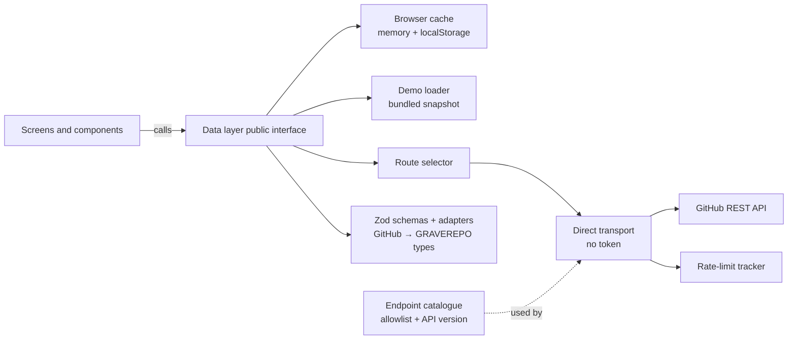
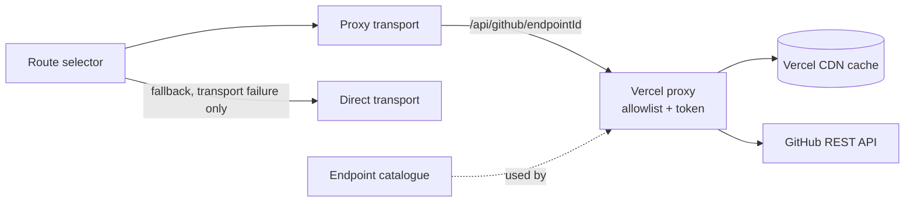
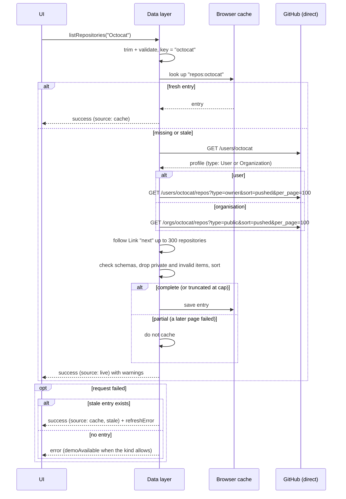

# Design: github-data-layer

## 1. Overview

The data layer sits between GRAVEREPO's screens and GitHub. It has five jobs:

1. **Fetch** public data from GitHub. In Phase 1 the browser calls GitHub directly. In Phase 2 an optional proxy is added.
2. **Convert** GitHub's responses into GRAVEREPO's own types, after checking them with Zod schemas.
3. **Cache** results in the browser.
4. **Explain** what happened: errors, rate limits and provenance.
5. **Provide** a bundled demo graveyard that always works.

Screens call a handful of functions and get back a **data result**: either a success with data, provenance and warnings, or a typed error. Both include the current rate-limit status. Screens never see raw GitHub responses or uncaught exceptions.

All decisions D1–D29 are approved. See the decision log in `requirements.md`. The schedule and checkpoint are in [`docs/roadmap.md`](../../../docs/roadmap.md).

---

## 2. Architecture

### 2.1 Phase 1 (MVP)



### 2.2 Phase 2 addition



Adding Phase 2 means adding the proxy transport, the proxy function and the route-selector fallback rule. Adapters, schemas, cache, demo and public functions stay the same, because both transports return the same **raw response** format.

### 2.3 Layers and import rules

| Layer | Location | Allowed to import | Never imports |
|---|---|---|---|
| UI | `src/components`, `src/screens` | Data layer public interface, data types | Transports, adapters, schemas, `fetch` to GitHub |
| Data layer | `src/data/github`, `src/data/cache`, `src/data/demo` | `shared/github-endpoints`, Zod | React |
| Endpoint catalogue | `shared/github-endpoints` | Nothing | Everything else |
| Proxy (Phase 2) | `api/github` | `shared/github-endpoints` | `src/` |

The **endpoint catalogue** is the single source of truth for:
- which GitHub endpoints GRAVEREPO may call,
- which query parameters each endpoint accepts,
- each endpoint's freshness window,
- the pinned GitHub API version.

The client uses it in Phase 1, and the proxy uses the same file as its allowlist in Phase 2, so the two can't drift apart.

---

## 3. Data flow

### 3.1 Looking up an account and listing its repositories



The profile is cached separately under `user:{login}`, so a list refresh can reuse a fresh profile.

### 3.2 Opening a tombstone (repository detail)

1. **Cache check.** Look up `detail:{owner}/{repo}` and return it if it's fresh.
2. **Step 1: core metadata (1 request).** If this fails (not found, forbidden, rate-limited, and so on), stop and return the error. The official owner and name from this response are used from here on (Requirement 6.10).
3. **Step 2: independent sections (5–6 requests, at most 4 at a time).**

| Section | Request | Notes |
|---|---|---|
| README | `readme` | "Not found" means "no README found" |
| Latest commit | `commits?per_page=1` | A 409 response ("repository is empty") marks the repository empty |
| Open issues | `issues?state=open&sort=created&direction=asc&per_page=100` | Skipped when core says issues are turned off |
| Branches | `branches?per_page=100` | Count only. Marked as a lower bound if 100 come back. |
| CI | `actions/runs?per_page=1` | No runs, or "not found", means "no workflow runs found" |
| Root folder | `contents` | Used for manifest detection. "Empty repository" means `not-applicable`. |

4. **Step 3: dependent sections (0–2 requests).**

| Section | Request only when | Otherwise |
|---|---|---|
| Recent authors | The latest commit is inside the 12-month window | 0 authors, no request. `not-applicable` if the repository is empty. |
| Manifest last change | The root folder contains a known manifest | "No manifest found in the root folder", or `not-applicable` if the repository is empty |

5. **Save.** Store the combined detail in the cache with one provenance.

**Optional sections (D26).** Manifest, branch count, CI and recent authors can each be switched off in the section configuration (design 4.2). A switched-off section is reported as `not-applicable: section-disabled` and sends no request. If development falls behind, switch them off in that order. Core metadata, README, latest commit and open issues are always on.

**How the merged issues request works.** Open items are sorted oldest first and include pull requests.
- The open-issue count is the number of non-pull-request items. It's a lower bound if 100 items were returned.
- The oldest open issue is the first non-pull-request item.
- If all 100 items are pull requests, the oldest issue is reported as "not found in the first 100 open items". It is **not** reported as "none".

### 3.3 Request counts for one repository detail

| Case | Requests |
|---|---|
| Repository not found, forbidden or rate-limited at step 1 | **1** |
| Empty repository | **7**: core, README, latest commit, issues, branches, CI, root folder. **6** when issues are turned off. |
| Minimum for a non-empty repository | **6**: issues turned off, latest commit older than 12 months, no manifest |
| Typical | **7–8** |
| Maximum | **9**: core, 6 independent sections, recent authors, manifest last change |
| Core sections only (all optional sections switched off) | **4–5**: core, README, latest commit, and issues unless turned off |

### 3.4 What direct mode can and cannot do

In direct mode, GitHub allows **60 requests per hour for each IP address**, without a token. A username search costs 2–4 requests (profile plus 1–3 repository pages), which leaves 56–58.

| Case | Opened tombstones after one search |
|---|---|
| Worst: 4-request search, 9-request details | 56 ÷ 9 = **6** |
| Typical: 7–8-request details | **7–8** |
| Best: 2-request search, 6-request details | 58 ÷ 6 = **9** |

These numbers are a ceiling, not a promise:
- **Shared networks:** everyone on the same network (an office, campus or judging venue) shares the same 60 requests, so the real number can be much lower.
- **Failed requests count:** "not found" and other failed responses still use up requests.
- **Extra searches:** each extra username search costs another 2–4 requests.
- **Cache:** reopening a repository from a fresh cache costs 0 requests.

For this reason, live mode is described as **limited**, and the demo graveyard is the **guaranteed** way to try GRAVEREPO. The demo never depends on live access (section 4.8).

### 3.5 Request estimate and budget check (D27)

**Before a detail starts,** `estimateDetailRequests` works out the most requests the detail could need, using only what is already known:

| Part | Counted as |
|---|---|
| Fresh cached detail exists | **0** in total. Nothing else is counted. |
| Core metadata | 1 |
| README, latest commit | 1 each |
| Open issues | 1, or 0 if the repository summary says issues are turned off |
| Branch count, CI, root folder | 1 each, or 0 if the section is switched off |
| Recent authors | 0 if switched off, or if the summary's last push is older than the 12-month window. Otherwise 1. |
| Manifest last change | 0 if the manifest section is switched off. Otherwise 1, because it isn't known yet whether a manifest exists. |

The estimate is always an upper bound: the detail never sends more requests than estimated.

**The budget check:**
- If the budget is known and smaller than the estimate, the result carries a `may-not-complete` warning with the estimate, the budget and the reset time.
- If no GitHub request has been made yet in this session, the budget is reported as **unknown** and no warning is given. There's no startup check (Req 8.16).

**While a detail runs:**
- After every response, the tracker updates the budget from the response headers. Other tabs, apps or people on the same network can be using the same allowance, so the budget can fall faster than expected.
- Before sending each further request, the runner checks the budget. If it has reached 0, or a primary rate limit was reported, the runner stops.
- Any section not yet fetched becomes `unavailable` with the reason `rate-limited`, and the sections already received are still returned.
- The UI can then say: "GitHub ran out of lookups part-way through. Some sections couldn't be checked. They'll be available after {time}."

**The warning is advisory only** and never stops the user from opening a tombstone.

### 3.6 Route selection

**Phase 1:**
1. If a primary rate limit is in effect for the direct route and the reset time hasn't passed, return `rate-limited` straight away without sending anything.
2. Otherwise, send the request in direct mode.

**Phase 2:**
1. Skip a route that is blocked by a primary rate limit.
2. Try the proxy.
3. Fall back to direct mode once, and **only** for these transport problems:
   - the proxy can't be reached (network failure or timeout),
   - the proxy returns its own server error, as opposed to a GitHub error it passed on.
4. **No fallback** for:
   - a rate limit reported by the proxy, primary or secondary,
   - GitHub answers such as 404, 403, 409 or 410,
   - GitHub server errors passed through by the proxy.

---

## 4. Components

### 4.1 Public interface (`src/data/github/index`)

These are the only functions screens may use.

| Function | Input | Returns | Network |
|---|---|---|---|
| `lookupUser` | username, options | Data result with a user profile | Yes |
| `listRepositories` | username, options | Data result with a repository list | Yes |
| `getRepositoryDetail` | owner, repo, options | Data result with a repository detail | Yes |
| `estimateDetailRequests` | repository summary | Request estimate, current budget (or unknown), and whether a `may-not-complete` warning applies | No |
| `loadDemoGraveyard` | none | Data result with the demo graveyard, including every repository's detail | No (never contacts GitHub) |
| `getRateLimitStatus` | none | Latest rate-limit status for each route | No |

**Options:** `signal` (cancellation) and `forceRefresh` (skip the browser cache).

**Cancellation:**
- Cancelling stops the result from being delivered to that caller, who receives `cancelled`.
- A network request shared with another caller keeps running.
- Only the 10-second timeout aborts a network request.
- When a new `lookupUser` call starts, the previous caller's lookup is cancelled in this way.

### 4.2 Endpoint catalogue (`shared/github-endpoints`)

**Pinned constants (one place only):**
- **API version** for the `X-GitHub-Api-Version` header. GitHub's docs currently show `2026-03-10`; confirm the value when implementing.
- **Accept header:** `application/vnd.github+json`.
- **Base URL:** `https://api.github.com`.

**MVP endpoints:**

| Endpoint ID | GitHub path | Allowed query parameters | Freshness |
|---|---|---|---|
| `user` | `/users/{owner}` | none | 10 min |
| `user-repos` | `/users/{owner}/repos` | `type=owner`, `sort=pushed`, `direction=desc`, `per_page` 1–100, `page` 1–3 | 10 min |
| `org-repos` | `/orgs/{owner}/repos` | `type=public`, `sort=pushed`, `direction=desc`, `per_page` 1–100, `page` 1–3 | 10 min |
| `repo` | `/repos/{owner}/{repo}` | none | 30 min |
| `readme` | `/repos/{owner}/{repo}/readme` | none | 30 min |
| `commits` | `/repos/{owner}/{repo}/commits` | `per_page` 1–100, `since` (ISO date), `path` (known manifest names only) | 30 min |
| `issues` | `/repos/{owner}/{repo}/issues` | `state=open`, `sort=created`, `direction=asc`, `per_page` 1–100 | 30 min |
| `branches` | `/repos/{owner}/{repo}/branches` | `per_page` 1–100 | 30 min |
| `workflow-runs` | `/repos/{owner}/{repo}/actions/runs` | `per_page=1` | 30 min |
| `root-contents` | `/repos/{owner}/{repo}/contents` | none | 30 min |

**Known manifests, in order:** `package.json`, `requirements.txt`, `pyproject.toml`, `Cargo.toml`, `go.mod`, `pom.xml`, `build.gradle`, `Gemfile`, `composer.json`.

**Section switches (D26):** one setting per optional section (`manifest`, `branches`, `ci`, `recentAuthors`), all on by default. Core sections have no switch. The demo capture script always captures every section, so switching a section back on later doesn't need a new capture.

**Validators:**
- **Username (D23):** 1–39 characters, letters, digits and hyphens only, not starting with a hyphen. GitHub decides everything else.
- **Repository name:** 1–100 characters, letters, digits, `.`, `-` and `_`, and not `.` or `..`.

**Deferred (D17):** a `sha` parameter on `commits`, used to get the last commit on a named branch. Branch names will be passed as a query value, so `/` is safe after standard encoding. The branch-name validator will use a subset of Git's rules:
- 1–255 characters,
- no spaces or control characters,
- none of `~ ^ : ? * [ \`,
- no `..` or `@{`,
- no `//`, and no `/` at the start or end,
- not ending in `.lock`, and no part starting with `.`.

### 4.3 Transports (`src/data/github/transport`)

**Transport interface:** a transport takes an endpoint ID, path values, query values, a timeout and a cancellation signal. It returns a **raw response**:

| Field | Meaning |
|---|---|
| `status` | HTTP status from GitHub |
| `data` | Parsed JSON, or a parse-failure marker |
| `fetchedAt` | When GitHub was contacted |
| `rateLimit` | Limit, remaining, reset time, `retry-after`, route, token used |
| `nextPage` | Page number read from the `Link` header, or none |
| `transportFailure` | Set only for network failures, timeouts, or (in Phase 2) the proxy's own errors |

**Direct transport (Phase 1):**
- Builds the URL from the catalogue.
- Sends the pinned headers and **no** `Authorization` header.
- Reads the `Link` header and rate-limit headers.
- Applies the 10-second timeout.
- The browser follows GitHub's redirects for renamed repositories automatically.

**Proxy transport (Phase 2):** calls `/api/github/{endpointId}` and reads the proxy's envelope into the same raw-response format.

### 4.4 Rate-limit tracker (`src/data/github/rate-limit`)

- Records the rate-limit values from every raw response, for each route.
- Classifies 403 and 429 responses:
  - remaining 0 → `primary`
  - a `retry-after` header or a secondary-limit message → `secondary`
  - anything else → `forbidden`
- Blocks a route until its reset time after a primary limit.
- Supplies the status that is attached to every data result and returned by `getRateLimitStatus`.

### 4.5 Pagination helper (`src/data/github/paginate`)

- Requests the next page while `nextPage` is set and fewer than 300 repositories have been collected.
- Stops at the cap. Sets `truncated` when the cap is hit and the profile's public count is higher.
- If a page fails, keeps the items collected so far and sets `partial`.

### 4.6 Schemas and adapters (`src/data/github/schemas`, `src/data/github/adapters`)

**Schemas:** one Zod schema per endpoint.
- Schemas describe only the fields GRAVEREPO reads, and ignore all other fields.
- Required fields are strict. Optional fields accept missing, null or the wrong type, and turn these into null.
- List endpoints check each item separately, so one bad item is dropped without failing the whole list.

**Adapters:** one per endpoint. Each adapter:
1. Runs the schema with Zod's non-throwing check (`safeParse`). A failure becomes `unexpected-response`.
2. Converts dates to ISO UTC, counts to whole numbers (or null when unknown), and empty optional text to null.
3. Drops repositories where `private` is true or `visibility` isn't `public` (Requirement 13.3), and counts them separately from invalid items.
4. Never reads or copies email fields (Requirement 13.1).
5. Never throws.

### 4.7 Cache (`src/data/cache`)

- **Two tiers:** an in-memory map in front of `localStorage`.
- **Key format:** `graverepo:v{schemaVersion}:{dataType}:{official identifiers in lowercase}`, for example `graverepo:v1:detail:octocat/hello-world`.
- **Entry contents:** schema version, fetch time, provenance and the normalised data.
- **Freshness:** an entry is fresh while `now − fetchTime` is less than the window from the catalogue.
- **What isn't cached:** partial lists (Requirement 7.8) and errors.
- **Unreadable entries** or entries with a different schema version are deleted.
- **When storage is full or fails:** remove every GitHub cache key (keys starting with `graverepo:`) from `localStorage` and continue with memory only for the rest of the session. Ritual progress is stored under the separate `graverepo-progress:` prefix (owned by the `resurrection-ritual` spec). The cache never reads, writes or removes those keys.
- **In-flight deduplication:** identical running requests share one promise. Each caller's cancellation only affects that caller.

### 4.8 Demo graveyard (`src/data/demo`)

**Location:** `src/data/demo/graveyard.snapshot.json`, plus a short `demo-notes.md` beside it. This location is separate from `tests/fixtures/` (Requirement 8.7).

**Sources (D9):**
1. The project owner's GitHub account. The username is to be provided.
2. A curated list of public repositories from other accounts. These are chosen only to fill states the owner's account doesn't cover.

**Before capture:**
- Check each candidate repository on GitHub for the required states in Requirement 8.5, using the GitHub MCP.
- Record which repository shows which state in `demo-notes.md`.
- If a state can't be found, write down the gap and propose options before creating any repository.

**Snapshot contents:**
- schema version, capture date, capture-script version,
- source accounts and the curated repository list,
- one user profile per source account,
- the raw GitHub responses for every summary and every detail request, with email fields removed and unused fields stripped.

**Loading:** the loader runs the snapshot through the same schemas and adapters as live data, and sets `source: demo`, `route: bundled` and `fetchedAt = capturedAt`.

**Delivery (D24):**
- **300 KB or smaller:** the snapshot is imported into the app bundle, so it arrives with the app itself.
- **Larger than 300 KB:** the snapshot is deployed as a static file next to the app (for example in Vite's `public/` folder), served from the same host. It is loaded once when the app starts and kept in memory, so it keeps working if the network drops afterwards.
- Check the size after capture (task 6.5) and choose the option then.
- In both cases the demo never contacts GitHub or any other external data service.

**No GitHub requests in demo mode (Req 8.13–8.17):**
- `loadDemoGraveyard` returns every repository's detail, so the ritual never needs `getRepositoryDetail` for a demo repository.
- Demo results are never passed to any transport.
- The app's startup doesn't call GitHub and doesn't check the rate limit.
- The demo is offered on the landing screen at all times, not only after errors. The button itself belongs in the `graveyard-dashboard` spec.
- Builds and tests read the committed snapshot and fixtures, never GitHub.

**What the demo graveyard looks like as data:**
- It's a collection, not one person's account.
- Its title ("Demo graveyard") is app text, not GitHub data.
- Each repository keeps its real owner.
- The data layer never presents it as the result of a username search (Requirement 8.10).

**Never:** constructed fixtures or hand-made values (Requirement 8.8). A test enforces this.

**Capture script (`scripts/capture-demo`):**
- Runs on your machine.
- May use your own token from a local environment variable, to avoid rate limits during capture. The token is never written to files.
- Reads the curated list from `demo-notes.md` or a small config beside it.
- Calls the MVP endpoints, removes emails and unused fields, and writes the snapshot.

### 4.9 Proxy (Phase 2, `api/github/[endpoint]`)

The proxy handles each request in this order:

1. **Method:** reject anything that isn't GET with 405.
2. **Allowlist:** look up the endpoint ID in the catalogue. Reject unknown IDs with 404, without contacting GitHub.
3. **Validation:** check path values with the catalogue validators and query values against the allowed values. Drop unknown parameters, and reject invalid values with 400.
4. **Forwarding:**
   - Send `Authorization: Bearer <GITHUB_TOKEN>`, but only if the variable is set.
   - Send the pinned headers.
   - Use an 8-second timeout.
   - Don't forward the visitor's cookies or headers.
5. **Response:** return one envelope containing the GitHub status, data, `fetchedAt`, rate-limit values and `nextPage`. The proxy reads `nextPage` from GitHub's `Link` header.
6. **Caching:**
   - `Cache-Control: public, s-maxage=<window>, stale-while-revalidate=60` for 200, 404, 409 and 410 responses.
   - `no-store` for rate limits and server errors.
7. **Logging:** log only the endpoint ID, status and duration. Never log the token or upstream error bodies.

**Token:** a fine-grained token with read-only access to public repositories only, stored as a Vercel environment variable.

**Documented risk (D12):** the proxy is public, so anyone who finds it can spend its 5,000-requests-per-hour allowance. The allowlist, validation and CDN caching reduce this risk but don't remove it. If the allowance runs out, visitors see the rate-limit message and can use the demo. Removing the token from Vercel turns the proxy into an unauthenticated pass-through.

---

## 5. Data models

These tables describe the shapes. They become TypeScript types during implementation, and most come from the Zod schemas.

### 5.1 Provenance

| Field | Type | Notes |
|---|---|---|
| `source` | `live` \| `cache` \| `demo` | |
| `route` | `direct` \| `proxy` \| `bundled` | |
| `fetchedAt` | ISO date | When GitHub was contacted, or the capture date for demo data |
| `stale` | boolean | True if served from cache after its freshness window |

### 5.2 Rate-limit status

| Field | Type |
|---|---|
| `route` | `direct` \| `proxy` |
| `limit` | whole number or null |
| `remaining` | whole number or null |
| `resetAt` | ISO date or null |
| `tokenUsed` | boolean |
| `blockedUntil` | ISO date or null |

### 5.3 Data result

| Case | Fields |
|---|---|
| Success | `ok: true`, `data`, `provenance`, `warnings`, `rateLimit`, `refreshError` (optional) |
| Failure | `ok: false`, `error`, `rateLimit` |

### 5.4 User profile

| Field | Type | Required |
|---|---|---|
| `login` | text, as GitHub spells it | Yes |
| `displayName` | text or null | No |
| `avatarUrl` | URL or null | No |
| `profileUrl` | URL | Yes |
| `accountType` | `user` \| `organisation` | Yes |
| `publicRepoCount` | whole number or null | No |

### 5.5 Repository summary

| Field | Type | Required | GitHub source |
|---|---|---|---|
| `id` | number | Yes | `id` |
| `owner` | text | Yes | `owner.login` |
| `name` | text | Yes | `name` |
| `fullName` | text | Yes | calculated: owner/name |
| `url` | URL | Yes | `html_url` |
| `description` | text or null | No | `description` |
| `primaryLanguage` | text or null | No | `language` |
| `stars` | whole number or null | No | `stargazers_count` |
| `forks` | whole number or null | No | `forks_count` |
| `openIssuesAndPullRequestsCount` | whole number or null | No | `open_issues_count` |
| `hasIssues` | boolean or null | No | `has_issues` |
| `isFork` | boolean | Yes | `fork` |
| `isArchived` | boolean | Yes | `archived` |
| `defaultBranch` | text or null | No | `default_branch` |
| `createdAt` | ISO date or null | No | `created_at` |
| `pushedAt` | ISO date or null | No | `pushed_at` |
| `sizeKb` | whole number or null | No | `size` |

A missing number is stored as null, never as 0, so "unknown" is never shown as "none". The `private` and `visibility` fields are read only to filter out repositories (Requirement 13.3) and aren't stored.

### 5.6 Repository list

| Field | Type |
|---|---|
| `owner` | User profile |
| `repositories` | List of repository summaries |
| `retrievedCount` | whole number |
| `totalPublicCount` | whole number or null |
| `truncated` | boolean |
| `partial` | boolean |
| `droppedInvalidCount` | whole number |
| `droppedPrivateCount` | whole number |

### 5.7 Repository detail

| Field | Type |
|---|---|
| `core` | Repository summary (official name) |
| `renamedFrom` | text or null |
| `isEmpty` | boolean |
| `sections` | One field result per section below |

A **field result** is one of:
- `available` with a `value`,
- `unavailable` with a `reason` (an error kind from 5.9),
- `not-applicable` with a `reason`: `empty-repository`, `issues-disabled` or `section-disabled`.

A section can also be `unavailable` with the reason `rate-limited` when the budget ran out during the detail and its request was never sent (design 3.5).

The detail has one provenance, held in the data result.

| Section | Value when available |
|---|---|
| `readme` | `found` (yes or no), plus a web URL when found |
| `latestCommit` | date (committer), short SHA, web URL, and author login or name |
| `recentAuthors` | window start, author count, `isLowerBound`, commits read (0 when skipped) |
| `openIssues` | count excluding pull requests, `isLowerBound`, the issues page URL, and `oldest` (created date, number, URL), or a note that no issue was found among the first 100 open items |
| `branches` | count, `isLowerBound` |
| `ci` | `found` (yes or no), plus the latest run's conclusion, date and URL when found |
| `manifest` | file name or none, last change date, commit URL |

### 5.8 Demo graveyard

| Field | Type |
|---|---|
| `capturedAt` | ISO date |
| `sourceAccounts` | List of user profiles |
| `repositories` | List of repository summaries, each with its real owner |
| `details` | One repository detail per repository |

### 5.9 Errors

| Kind | Cause | Retryable by user | Demo offered | Draft user message (final wording comes from the voice steering doc) |
|---|---|---|---|---|
| `invalid-username` | Fails the username validator | Yes, after editing | No | "That name won't fit on a tombstone. GitHub usernames use letters, numbers and hyphens." |
| `user-not-found` | 404 on `user` | Yes, after editing | No | "We searched every row and found no account called *{name}*." |
| `repo-not-found` | 404 on `repo` | No | No | "This grave is empty. The repository may have moved, been renamed or been made private." |
| `rate-limited` (primary) | 403 or 429 with remaining 0 | After `resetAt` | Yes | "The lanterns are out of oil. GitHub allows more lookups at {time}." |
| `rate-limited` (secondary) | 403 or 429 with `retry-after` or a secondary message | After `retryAfter` seconds | Yes | "Too many spirits at once. Try again in {seconds} seconds." |
| `forbidden` | Other 403 | No | No | "GitHub won't let us see this one." |
| `timeout` | No response in time | Yes | Yes | "The fog is too thick. GitHub didn't answer in time." |
| `network` | Offline or request failed | Yes | Yes | "We can't reach GitHub from here. Check your connection." |
| `github-unavailable` | GitHub 5xx | Yes | Yes | "GitHub seems to be having a rough night." |
| `proxy-unavailable` | (Phase 2) Proxy down and direct mode also failed | Yes | Yes | "Our lantern-keeper isn't answering right now." |
| `unexpected-response` | Bad JSON or failed schema | Yes | Yes | "GitHub sent something we didn't expect." |
| `demo-unavailable` | Demo snapshot failed validation | No | No | "The demo graveyard is missing. Please report this." |
| `cancelled` | Caller cancelled or was replaced by a newer lookup | n/a | n/a | No message; the UI ignores it |

Every error carries a `kind`, a `messageKey`, `details` (for example `resetAt`), a `demoAvailable` flag and a `retryable` flag.

### 5.10 Warnings

Warnings sit alongside successful data. They aren't errors.

| Warning | When | Details |
|---|---|---|
| `partial-list` | A later repository page failed | number retrieved |
| `truncated-list` | The 300-repository cap was reached and more exist | retrieved and total counts |
| `dropped-items` | Invalid or private items were left out | invalid and private counts |
| `may-not-complete` | The known budget was smaller than the request estimate when a detail started | estimate, budget, reset time |
| `stale-data` | Stale cache was served because a refresh failed | age, refresh error kind |

---

## 6. Freshness explained to users

The UI (another spec) turns provenance into short labels:

| Situation | Example label |
|---|---|
| Live, just fetched | "Fresh from GitHub, just now" |
| Browser cache, fresh | "Saved copy from 8 minutes ago" |
| Browser cache, stale after an error | "Saved copy from 2 hours ago. We couldn't refresh it: {reason}" |
| Demo | "Demo graveyard, captured on {date}" |
| (Phase 2) From the proxy's shared cache | "From GitHub, checked 6 minutes ago" |

---

## 7. Folder layout for this spec

```
shared/
  github-endpoints/           catalogue, pinned API version, validators
api/
  github/                     (Phase 2) Vercel proxy function
src/data/
  github/
    index                     public interface
    transport/                direct (Phase 1), proxy (Phase 2)
    rate-limit/
    paginate/
    schemas/                  Zod schemas, one per endpoint
    adapters/                 one per endpoint
    errors/                   error kinds + mapping from responses
    detail/                   three-step detail runner
  cache/
  demo/
    graveyard.snapshot.json   real captured data only (bundled if 300 KB or smaller)
    demo-notes.md             sources, curated list, state coverage, gaps
public/
  demo/                       only used if the snapshot is larger than 300 KB (D24)
scripts/
  capture-demo/
tests/
  fixtures/github/
    captured/                 real responses + metadata file per fixture
    constructed/              hand-made error and edge cases, clearly labelled
  data-layer/                 unit, property and integration tests
```

---

## 8. Testing strategy

All tests use **Vitest**. Property tests use **fast-check**. No test calls the real GitHub API. Tests use fixtures and a fake `fetch`.

### 8.1 Fixtures

**`captured/`:** real GitHub responses gathered with the GitHub MCP or the capture script.
- Each fixture has metadata: endpoint, capture date, and source account or repository.
- Email fields are removed. Nothing else is edited.
- **Planned cases:**
  - a user profile and an organisation profile,
  - repository lists for a user and for an organisation,
  - an archived repository, a fork, and a repository without a README,
  - a repository with and without workflow runs,
  - a repository with issues turned off,
  - an empty repository (the 409 response) and a renamed repository, if real examples are found,
  - a root folder listing with a manifest.

**`constructed/`:** hand-made, with each file marked as constructed and describing its case.
- primary rate limit (403 and 429 with remaining 0),
- secondary rate limit (with `retry-after`),
- a plain 403, 5xx responses and broken JSON,
- missing or wrong-type fields,
- a repository list containing a private item,
- a `Link` header for an account with more than 300 repositories,
- 100 open items that are all pull requests,
- 100 branches, for the lower bound,
- an empty repository or renamed repository, if no real one is captured.

**Rule:** tests of normal conversions use captured fixtures only (Requirement 14.4).

### 8.2 Schema and adapter tests (unit)

- Every captured fixture converts into the expected normalised output.
- Missing optional fields become null. Missing required fields drop the item with a warning.
- Private items are dropped and counted.
- Pull requests aren't counted as issues. The oldest issue is the first non-pull-request item.
- Lower bounds are set when 100 items come back.
- Commit dates use the committer date.
- No adapter output contains an email field.

### 8.3 Error-handling tests (unit)

- Each status and header combination maps to the right error kind (table 5.9).
- Timeouts produce `timeout`. A replaced lookup produces `cancelled`.
- When core metadata fails, no other detail requests are sent.
- One failing section leaves the other sections available.
- No public function throws.

### 8.4 Detail runner tests (unit)

- Core is requested first. The other sections start only after it succeeds.
- No more than 4 requests run at once.
- The recent-authors request is skipped when the latest commit is older than 12 months.
- The issues request is skipped when issues are turned off.
- The manifest request is skipped when no manifest is found.
- An empty repository gives `not-applicable` commit and manifest sections.
- A renamed repository uses the official name and sets `renamedFrom`.
- The request count stays between 1 and 9 in every scenario.
- A switched-off optional section is `not-applicable: section-disabled` and sends no request.
- **Budget (D27):**
  - The estimate is 0 when a fresh cached copy exists.
  - The estimate drops when sections are switched off, issues are turned off, or the last push is outside the window.
  - `may-not-complete` is set only when the budget is known and smaller than the estimate. An unknown budget gives no warning.
  - If the budget reaches 0 part-way through, no further requests are sent. The remaining sections are `unavailable: rate-limited`, and received sections are kept.
  - The warning never stops the detail from running.

### 8.5 Pagination tests (unit)

- The helper follows `nextPage` and stops at 300.
- `truncated` is set when the cap is hit and more repositories exist.
- If page 2 fails, the items from page 1 are returned with `partial` set.
- Users use `user-repos` and organisations use `org-repos` with `type=public`.

### 8.6 Caching tests (unit, with fake timers)

- Inside the window: served from cache with no request.
- After the window: a request is sent, and success replaces the entry.
- Failure with a stale entry: the stale entry is served with `refreshError`.
- Partial lists aren't cached. Lists truncated at the cap are.
- Entries with the wrong schema version, or corrupted entries, are deleted.
- A storage write error clears the GitHub cache keys (`graverepo:` prefix) and switches to memory only. Keys with the `graverepo-progress:` prefix are left untouched.
- Two identical concurrent calls send one request. Cancelling one caller doesn't affect the other.
- `forceRefresh` skips the cache.

### 8.7 Rate-limit tests (unit)

- Header values are recorded, and every data result includes the status.
- After a primary limit, the route is blocked until the reset time, and cache is still served.
- Nothing is retried automatically.

### 8.8 Demo tests

- The snapshot passes the same schemas and adapters with no dropped items.
- Every repository has a matching detail.
- The provenance is `demo` and includes the capture date.
- The snapshot contains no email addresses or token patterns.
- The snapshot contains no constructed fixture content. Constructed fixture files carry a marker, and the test checks that no marker appears in the snapshot.
- The states listed in `demo-notes.md` match what the snapshot actually contains, for example at least one archived repository.
- **No GitHub requests in demo mode (Req 8.13, 8.19):** replace `fetch` with a version that fails the test if it's called for any GitHub URL. Then load the demo graveyard and read every repository's detail. The test fails if any GitHub request is attempted. The `resurrection-ritual` spec extends this test to complete a full demo ritual.
- **Startup (Req 8.16):** starting the data layer, before any user action, sends no request.
- **Delivery (Req 8.14):** a test fails if the snapshot is larger than 300 KB while still imported into the bundle.

### 8.9 Property-based tests (fast-check)

| Property | Guards |
|---|---|
| For any JSON value, every adapter returns a valid result or `unexpected-response`, and never throws | Req 6.9 |
| For any adapter output, every count is null or a whole number of zero or more, and every date is null or a valid ISO string | Req 5.3, 5.4 |
| For any sequence of pages, no more than 300 repositories are retrieved | Req 3.4 |
| For any list of repositories, the sorted output puts more recent pushes first and null pushes last, and keeps every valid public item | Req 2.6 |
| For any list containing private items, the output contains none of them | Req 13.3 |
| For any string, the username validator accepts it exactly when it follows the rules in D23 | Req 1.2 |
| For any combination of detail outcomes, the number of requests is between 1 and 9 | Req 4.11 |
| For any fetch time and current time, an entry is fresh exactly when its age is under the window | Req 7.2–7.4 |
| For any data result built from cache or demo data, the source is never `live` | Req 10.3 |
| For any repository summary, section switches and detail outcomes, the number of requests sent is never more than the estimate | Req 9.10 |
| For any budget sequence that reaches 0 part-way through, no request is sent after that point | Req 9.14 |

### 8.10 Security and privacy checks

- A test (and a Kiro hook on save) scans `src/`, `shared/` and the build output for token patterns (`ghp_`, `github_pat_`, `gho_`).
- A test scans the demo snapshot, the captured fixtures and the adapter outputs for email patterns.

### 8.11 Phase 2 tests (only if the proxy is built)

- Non-GET requests get 405. Unknown endpoints get 404 without contacting GitHub. Invalid values get 400.
- The token is sent to GitHub only, and never appears in responses or logs.
- `Cache-Control` values match the catalogue.
- Proxy network failure: direct mode is tried once.
- Proxy rate limit or GitHub 404: direct mode is not tried.

### 8.12 Manual checks

These feed the checkpoint checks in `docs/roadmap.md`.

- **Deployed app in direct mode:** search a user, search an organisation, open several tombstones.
- **Demo with GitHub blocked:** block `api.github.com` in DevTools, open the demo, and complete a ritual. Confirm that 0 requests reach GitHub.
- **Offline after load:** load the app, go offline, and confirm the demo graveyard and the full ritual still work.
- **Rate limit:** use up the direct-mode allowance. Check the message, the `may-not-complete` warning and the demo offer.
- **Requests:** in DevTools, confirm that no request carries an `Authorization` header in Phase 1.

---

## 9. Correctness properties (summary)

1. No raw GitHub object reaches the UI.
2. No public function throws.
3. No value is invented. Every value comes from a GitHub response or is calculated from one.
4. Cached and demo data are never labelled as live.
5. Demo data is never shown as a searched user's data, and never contains constructed fixtures.
6. No email address is stored anywhere.
7. No private repository is ever returned.
8. No token is present in frontend code or output.
9. No more than 300 repositories per account, no more than 9 requests per detail (and never more than the estimate), and no more than 4 requests at once.
10. The demo makes zero GitHub requests, and the app starts without any GitHub request.
11. (Phase 2) The proxy never forwards a request outside the catalogue.
