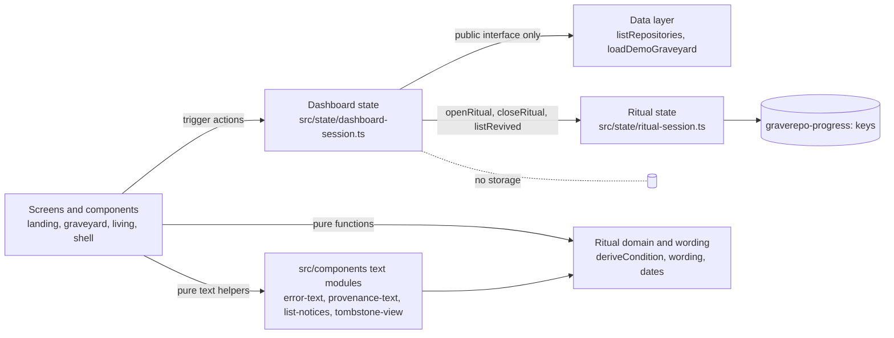
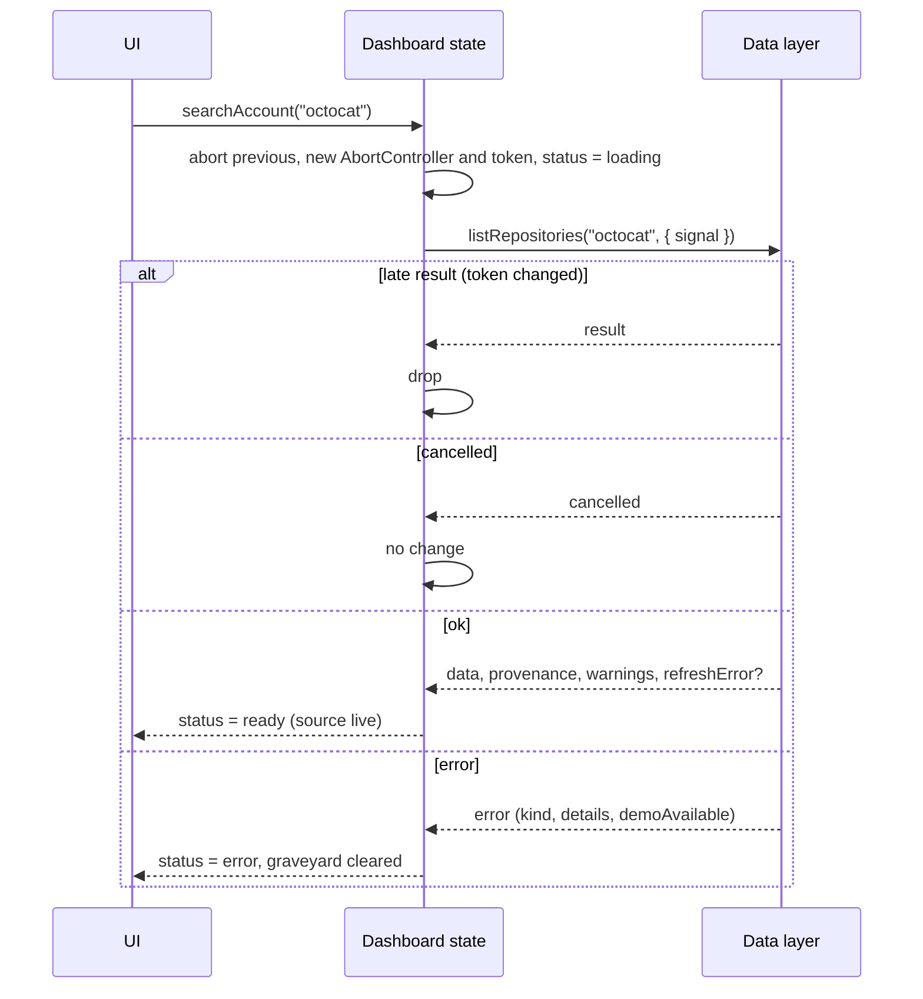

# Design: graveyard-dashboard

**Status:** Ready for implementation. See `requirements.md` for the requirements (R1 to R14) and the decisions made here (DD1 to DD10).

## 1. Overview

The dashboard is a thin layer of screens, small state actions and a few pure text helpers. It owns no GitHub logic and no ritual logic.

| View | What the visitor sees | Data comes from |
|---|---|---|
| Landing | Name, tagline, introduction, search form, demo button, the four stages | Nothing (static) |
| Graveyard | Account heading, provenance label, notices, filters, tombstones | `listRepositories` (live) or `loadDemoGraveyard` (demo), through the state layer |
| Ritual | The ritual's own screens, plus "Back to the graveyard" | The ritual spec |
| The Living | Revived repositories, note, empty state | `listRevived()` from the ritual state |

Design principles:

1. **Show, don't decide.** Conditions, dates and labels come from ritual functions.
2. **One way in for data.** UI triggers actions. State calls the data layer's public interface.
3. **Source is always visible.** Live, saved copy or demo is shown on the list, and demo is never mixed with live.
4. **Small and static first.** No router, no animation, no remote images.
5. **Honest about gaps.** Truncated, partial and unknown are stated, never hidden.

## 2. Architecture



### 2.1 Layers (no change to `tech.md`)

| Layer | Dashboard contents | Rules |
|---|---|---|
| UI | `src/App.tsx`, `src/screens/landing`, `src/screens/graveyard`, `src/screens/living`, `src/components` | Triggers state actions. Imports state, pure domain functions and data **types** only. |
| State | `src/state/dashboard-session.ts`, `graveyard-filters.ts`, `display-context.ts`, `clock.ts` | Creates `AbortController`s, calls the data layer's public interface and the ritual's actions, holds results as returned. |
| Pure text helpers | `src/components/error-text.ts`, `provenance-text.ts`, `list-notices.ts`, `tombstone-view.ts` | No clock, no storage, no network. Take `now` and the display context as arguments. |

### 2.2 Folder layout

```
src/
  App.tsx                       app shell: header, skip link, view switch, error boundary, footer
  state/
    dashboard-session.ts        view, graveyard view state, actions
    graveyard-filters.ts        filterRepositories (pure), default filters
    display-context.ts          { locale, timeZone } read once from Intl, with fallback (shared with the ritual)
    clock.ts                    injectable now() (shared with the ritual)
  components/
    Tombstone.tsx / .css        one card
    ConditionIcon.tsx           simple SVG shapes, hidden from assistive technology
    SearchForm.tsx / .css
    Notice.tsx / .css           variants: info, warning, error, success (icon + text)
    DataSourceBadge.tsx / .css  live, saved copy or demo, with time
    LoadingIndicator.tsx / .css static under reduced motion
    error-text.ts               shared error wording (DD9)
    provenance-text.ts          provenance label text
    list-notices.ts             warnings -> notices
    tombstone-view.ts           summary + reference time + display context -> card view model
  screens/
    landing/                    Landing.tsx
    graveyard/                  Graveyard.tsx, GraveyardToolbar.tsx
    living/                     Living.tsx
  styles/                       tokens.css, base.css (shared with the ritual)
tests/dashboard/                unit, property, state and scan tests
```

Files shared with the ritual spec are created by whichever task needs them first (section 10). The other spec's tasks reuse them.

## 3. State

### 3.1 Shape

```
view:        'landing' | 'graveyard' | 'ritual' | 'living'
graveyard:   { status: 'idle' }
           | { status: 'loading', source: 'live' | 'demo', name?: string, isSlow: boolean }
           | { status: 'error', error, query }           // error from the data layer, as returned
           | { status: 'ready', source: 'live' | 'demo', result }   // the ok data result as returned
filters:     { text: string, includeForks: boolean, includeArchived: boolean }
revivedCount: number                                        // from listRevived()
```

- `result` is the data result as returned: `data` (list or demo graveyard), `provenance`, `warnings`, optional `refreshError`.
- `query` is the text the visitor typed, kept so the form stays filled.
- Nothing is saved to storage (R11.6).

### 3.2 Actions

| Action | Effect |
|---|---|
| `searchAccount(text)` | Aborts any running search, creates a new `AbortController` and a request token, sets `loading`, calls `listRepositories(text, { signal })`. A result with a stale token is dropped. `cancelled` changes nothing. `ok` sets `ready` (`source: 'live'`) and resets filters. `ok: false` sets `error` and clears the graveyard (DD4). |
| `openDemo()` | Aborts any running search. Calls `loadDemoGraveyard()` (no network). `ok` sets `ready` (`source: 'demo'`) and resets filters. `demo-unavailable` sets `error`. |
| `setFilters(partial)`, `clearFilters()` | Update filters. No request. |
| `openTombstone(owner, repo)` | Finds the summary in the current result, calls the ritual's `openRitual({ owner, repo, summary }, source)` where `source` is the graveyard's source, then sets `view = 'ritual'`. Ignored unless `graveyard.status === 'ready'`. |
| `backToGraveyard()` | Calls the ritual's `closeRitual()` and sets `view = 'graveyard'`. The result and filters are unchanged. |
| `showLiving()` | Refreshes `revivedCount` and the list from `listRevived()`, sets `view = 'living'`. |
| `goHome()` | Sets `view = 'landing'`. If a ritual is open, calls `closeRitual()` first. Keeps the graveyard result in memory so the visitor can return through the header. |
| `refreshRevivedCount()` | Reads `listRevived()` (local only). Called at startup and when a view changes. |

Rules:
- The state layer, not components, creates `AbortController`s and drops late results (tech.md section 6).
- Opening the app calls no data-layer function (R1.6). `refreshRevivedCount` reads local storage through the ritual only.
- A `ready` demo result and a `ready` live result are never held at the same time. Starting one replaces the other (R8.8).
- `source` for a tombstone comes from `graveyard.source`, never from the tombstone (R6.4).
- A late result after `openDemo()` or a newer search is dropped by the token.
- **Revived order contract.** The ritual guarantees that `listRevived()` returns records newest first by `revivedAt` (ritual design sections 3.4 item 3 and the actions table). The dashboard shows the list in the order returned and does not sort it again.
- **"Taking a while" timer.** `searchAccount` starts one 8-second timer when it sets `loading`, and sets a `isSlow` flag on the loading state when it fires. The state layer holds the single timer handle and clears it (`clearTimeout`) in every one of these cases: the search returns `ok`, returns `ok: false`, returns `cancelled`, is aborted by a newer `searchAccount`, is replaced by `openDemo()`, or the app state is disposed. A new search clears the old timer before starting its own. A timer callback also checks its request token and does nothing if the token is stale. `isSlow` is false in every state other than `loading`. `openDemo()` starts no timer.

### 3.3 Display context and clock

- `display-context.ts` reads `Intl.DateTimeFormat().resolvedOptions()` once and returns `{ locale, timeZone }`, with the fallback `en` and `UTC` (labelled "UTC" by the wording functions). It is the same context the ritual uses (ritual O21). Only the state layer or app shell reads it.
- `clock.ts` exports `now()` returning an ISO string. Tests replace it. Pure helpers receive `now` as an argument.

## 4. Pure helpers

### 4.1 `filterRepositories(repositories, filters)`

- Lower-cases the text and keeps a repository when its name or description contains it (an empty text keeps all). A `null` description never matches a non-empty text.
- Drops forks when `includeForks` is false, and archived when `includeArchived` is false.
- Keeps the original order. Never adds items. Returns a new list.

### 4.2 `describeProvenance(provenance, refreshError, displayContext, now)`

| Provenance | Label |
|---|---|
| `source: live`, not stale | "Fresh from GitHub, just now" |
| `source: cache`, not stale | "Saved copy from {age}" |
| `source: cache`, stale (with `refreshError`) | "Saved copy from {age}. We couldn't refresh it: {reason}" |
| `source: demo` | "Demo graveyard, captured on {date}" |
| (Phase 2) shared cache | "From GitHub, checked {age} ago" |

- `{age}` is a plain English phrase from `now − fetchedAt` ("8 minutes", "2 hours"). The exact time goes in a `title`. `{reason}` comes from `error-text`.
- "Fresh from GitHub" appears only for `live` and not stale. A cache or demo result never gets it.
- The label always comes from the `provenance` (and `refreshError`) of the result actually returned. A successful result is never assumed to be fresh from GitHub, and the label is never chosen from which action was called (a live search can return a saved copy). A provenance combination not in the table (for example `live` and stale) gets no "Fresh from GitHub" claim, and is reported at verification gate task 1.3 rather than guessed.
- The same function is used by the ritual's Necropsy (DD9).

### 4.3 `listNotices(listResult)`

Builds notices from `warnings` and the list, in this order:

| Condition | Notice (variant) |
|---|---|
| `truncated` | "Showing the {n} most recently updated of {total} repositories." (info) |
| `partial` | "Some repositories couldn't be loaded. Showing {n} of {total}." (warning). Without a total: "Some repositories couldn't be loaded. Showing {n}." |
| `droppedInvalidCount > 0` | "{n} repositories couldn't be shown." (info) |
| `provenance.stale` with `refreshError` | Covered by the provenance label, not repeated. |

`droppedPrivateCount` is never shown and private repositories are never mentioned. Empty accounts are handled by the screen, not by a notice.

### 4.4 `tombstoneView(summary, referenceTime, displayContext, source)`

Returns a view model, with no markup:

```
{ key, name, owner (shown for demo), description | null,
  condition: { id, label },           // from deriveCondition({ isArchived, isEmpty: null, pushedAt }, referenceTime)
  fact: string,                       // "Last updated 14 months ago (3 Mar 2025)", date only for future dates, "Last update not available"
  flags: [ 'archived' | 'fork' ],
  language | null,
  accessibleName }
```

- Calls `deriveCondition` and the ritual wording functions. Contains no threshold or boundary.
- `accessibleName` = "{name}. {condition label}. {fact}. Archived. Fork." (only the flags that apply), followed by "Open to look at the evidence."
- Nothing in this function says active, healthy or recently updated for an archived repository (the ritual's wording guarantees it, and a test checks the card).

### 4.5 `errorText(error, context)`

One function for all data-layer errors (R9.4). `context = { displayContext, now, demoAvailable }`, where `demoAvailable` comes from the error itself.

| Kind | Text (voice 5.8) | Demo sentence |
|---|---|---|
| `network` | "We can't reach GitHub from here. Check your connection" | "or try the demo graveyard." |
| `timeout` | "GitHub didn't answer in time. Try again" | "or try the demo graveyard." |
| `rate-limited` primary | "GitHub allows only a limited number of lookups for each hour. We've used them up for now. You can look again at {time}" | "or try the demo graveyard." |
| `rate-limited` secondary | "Too many lookups at once. Try again in {seconds} seconds." | none |
| `github-unavailable` | "GitHub seems to be having trouble right now. Try again later" | "or try the demo graveyard." |
| `unexpected-response` | "GitHub sent something we didn't expect. Try again" | "or try the demo graveyard." |
| `proxy-unavailable` (Phase 2) | "Our lookup helper isn't answering right now. Try the demo graveyard, or try again later." | built in |
| `forbidden` | "GitHub won't let us see this one." | none |
| `user-not-found` | "We couldn't find an account called {name}. Check the spelling." | none |
| `repo-not-found` | "We couldn't find this repository. It may have been renamed, moved or made private." | none |
| `invalid-username` | "GitHub usernames use letters, numbers and hyphens." | none |
| `demo-unavailable` | "The demo graveyard couldn't be loaded. Please report this." | none |
| `cancelled` | no message | none |

- The demo sentence is added only when `demoAvailable` is true. The module returns structured parts (message, demo offer, retry time) so the UI can place the demo button.
- `{time}` uses the display context, with the date when it is not today (compared with `now`).
- A rate limit is never described as the visitor's failure. `forbidden` is never described as a rate limit.
- A short heading ("The lanterns are out of oil") may be returned as a separate mood line, with the plain message under it (voice 5.8).

## 5. Screens

### 5.1 App shell (`App.tsx`)

- Skip link, `header` with logo (to landing), "Demo graveyard" and "The Living ({n})" in a `nav`, one `main`, footer note (R10.7).
- Switches on `view`. On a view change, focus moves to the view's `h1` (the ritual manages its own stage heading).
- One error boundary around the app with a friendly fallback.
- A polite live region (status) and the alert region live inside the views, not the shell.

### 5.2 Landing

| Part | Content |
|---|---|
| Hero | "GRAVEREPO", tagline, intro paragraph (design 8.1), static SVG tombstone and ghost (decorative) |
| Search | `SearchForm` and the demo button ("Explore the demo graveyard") side by side. One primary action: Search. |
| Stages | A list of four items with plain meanings |
| Empty line | "Search for a GitHub username, or explore the demo graveyard." |

States: no loading, no data. If a search starts, the view switches to the graveyard view in its loading state.

### 5.3 Graveyard

| Part | Content |
|---|---|
| Heading | Live: "Graveyard of {login}", plus "Organisation" when it is one, plus the profile link. Demo: "Demo graveyard" and the source accounts. |
| Provenance | `DataSourceBadge` with `describeProvenance` text |
| Notices | From `listNotices` |
| Search | Compact `SearchForm` |
| Toolbar | Text filter, "Include forks", "Include archived", count text, "Clear filters" when filtered |
| List | `ul` of `Tombstone` buttons |

| State | What shows |
|---|---|
| Loading | "Looking for {name}…" (live) or "Opening the demo graveyard…" (demo), indicator, polite region. When `isSlow` is true (8 seconds, section 3.2), add "GitHub is taking a while. You can keep waiting or try the demo." |
| Error | `Notice` (error) with the message from `errorText`, the search form (filled), the demo button only when `demoAvailable`, a retry button when retryable. `invalid-username` is shown next to the field. |
| Empty account | "{name} has no public repositories yet. Nothing to dig up here." |
| Empty filter | "No repositories match these filters. Clear the filters to see all {n}." and a "Clear filters" button |
| Partial / truncated / dropped | Usable list with notices |
| Stale | Usable list with the "couldn't refresh it" provenance label |
| Success | List and count |

### 5.4 Tombstone card

- A `button` (or a link-styled button) inside an `li`, so the whole card is one control, with `aria-label` from `accessibleName`.
- Content, top to bottom: name (and `owner/` in the demo), condition icon and label, fact, flag icons with text, language, description.
- Condition icons are simple inline SVG shapes (one per condition) with `aria-hidden`. The text label is always present.
- Styles use tokens only. Archived, fork and resting cards differ by icon and text first, and by a light texture or colour second. No cobwebs or cracks over text.
- Focus ring uses the focus token and is not removed.

### 5.5 The Living

| Part | Content |
|---|---|
| Heading | "The Living" |
| Note | "GRAVEREPO doesn't change anything on GitHub." |
| List | One `li` per record: "{owner}/{repo}", caption "Revived in GRAVEREPO on {date}", source label, "Archived on GitHub" with an icon when `wasArchived`, GitHub link (https only) |
| Empty | "No revived repositories yet. Finish a ritual and it will grow here." |
| Picture | Optional static decorative picture (aria-hidden). The text list is the authority. |

States: no loading (local read), no error. Unreadable records are already filtered out by the ritual's `listRevived()`. If the read itself throws, the error boundary shows the fallback.

## 6. Data flow

### 6.1 Live search



### 6.2 Demo

`openDemo()` calls `loadDemoGraveyard()`, which is in memory and never contacts GitHub. The result's `data` holds the repository summaries and every repository's detail. The dashboard keeps only the summaries for the list. The ritual loads the details itself (ritual 3.1).

### 6.3 Opening a tombstone

`openTombstone(owner, repo)` finds the summary, calls `openRitual({ owner, repo, summary }, source)` and switches the view. From here the ritual owns loading, errors, estimate warnings and cancellation. "Back to the graveyard" calls `closeRitual()` and returns to the unchanged list.

### 6.4 After a reload

The app opens on the landing page. For the demo, the visitor opens the demo again, opens the same tombstone, and the ritual restores its saved stage and ticks (ritual O16). For live, the visitor searches again. The data layer's cache makes this quick when the copy is fresh.

## 7. Styling

- Plain CSS, one file per component, class names prefixed by component (tech.md section 4).
- Mobile first. The tombstone grid is one column on small screens, and more columns as the width grows. No horizontal scrolling at 320px.
- Colour and spacing come from `styles/tokens.css`. The final colour values are chosen in task 4.1, checked against the contrast ratios (4.5:1 body, 3:1 large text and controls) and recorded in the file. The typeface is a system font stack (no remote fonts).
- Decorative SVGs (tombstone, ghost, sprouts) are inline or bundled, light, static and `aria-hidden`.
- A `prefers-reduced-motion: reduce` block exists for every animation, and there is no animation in the first version.

## 8. Wording

All dashboard text lives in dashboard text modules (R12.1). Honesty-bearing lines use the voice document. The new lines below are proposed.

### 8.1 Wording (status: partial-list, error, count and age lines approved and in `voice-and-honesty.md` 5.8 and 5.10; the introduction, footer note and stage meanings below are still not approved, so the fallback applies)

| Item | Proposed text | Needs voice update? |
|---|---|---|
| Tagline | "Dig up your forgotten code." | No (design system) |
| Introduction | "GRAVEREPO looks at a GitHub account's public repositories and shows what can be seen about each one. Open a tombstone to look at the evidence, get a suggested plan and tick it off. GRAVEREPO only reads public GitHub data. It doesn't change anything on GitHub, and \"revived\" only means you finished the steps here." | Yes |
| Footer note | "GRAVEREPO reads public GitHub data only. It doesn't change anything on GitHub." | Yes |
| Stage meanings | Necropsy: look at the evidence. Plan: a suggested list of steps. Rising: tick the steps off. The Living: repositories you revived here. | Yes (the voice document gives "Look at the evidence" and "Progress" for two) |
| Partial list, total unknown | "Some repositories couldn't be loaded. Showing {n}." | Yes (variant of 5.9) |
| Graveyard heading | "Graveyard of {login}" and "Demo graveyard" | No (theme use is allowed) |
| Control labels | "GitHub username or organisation", "Search", "Explore the demo graveyard", "Include forks", "Include archived", "Clear filters", "Back to the graveyard", "The Living ({n})" | No (interface labels, not claims) |
| Tombstone prompt | "Open to look at the evidence." | No |
| No description | "No description provided" | No (a fact) |

Fallback until the voice update is approved: show the tagline, the empty-state line and the controls only, and use the voice document's existing lines for everything else. The landing page then has no introduction paragraph. This does not block the checkpoint.

### 8.2 Wording safety

- Text templates contain none of the avoided words (voice 3). Repository names and descriptions from GitHub are shown as given and are not checked.
- "Revived" always appears with GRAVEREPO or the local-only note.
- No text states why a repository is quiet.

## 9. Testing strategy

Vitest and fast-check. No test reaches GitHub. State tests use a fake data layer and a fake ritual state (spies for `openRitual`, `closeRitual`, `listRevived`). Component tests are limited until the component test tool is chosen (`tech.md` open). The keyboard path is a manual check.

### 9.1 Unit tests

| ID | Subject | Checks |
|---|---|---|
| D-U1 | `filterRepositories` | Text match on name and description, case-insensitive, `null` description, forks and archived toggles, empty text keeps all, order kept, no request. |
| D-U2 | `describeProvenance` | All five situations. "Fresh from GitHub" only for live and not stale. Demo and cache never say live. Stale includes the reason. Age phrases at 0, 1, 59 minutes, hours, days. The label follows the returned provenance: a live search that returns a `cache` result gets the saved-copy label, never the fresh one. An unlisted combination gets no "Fresh" claim. |
| D-U3 | `errorText` | Every kind. Demo sentence only when `demoAvailable`. `cancelled` gives no message. Primary rate limit shows the time in the display context, with the date when not today. `forbidden` never mentions a rate limit. |
| D-U4 | `listNotices` | Truncated, partial (with and without total), dropped invalid, none. Private is never mentioned or counted. Stale is not repeated. |
| D-U5 | `tombstoneView` | Condition comes from `deriveCondition` with `isEmpty: null`. `pushedAt` null gives "Last update not available" and no resting label. A future date shows the date only. Archived never reads active or recently updated. `sizeKb` 0 does not give "Empty". Fork flag. Unknown language left out. Missing description gives "No description provided". Accessible name includes name and status. Reference time is the list's `fetchedAt`. |
| D-U6 | Display context | Fallback `en` and `UTC` when `Intl` gives nothing. |

### 9.2 State tests (fake data layer)

| ID | Subject | Checks |
|---|---|---|
| D-S1 | Search paths | Success shows `ready` with provenance, warnings and `refreshError` as returned. Empty list. Each error kind sets `error`, clears the graveyard and keeps the query. `demoAvailable` false gives no demo offer. |
| D-S2 | Cancellation | A second search aborts the first. A late first result is dropped and does not change state. `cancelled` changes nothing. |
| D-S3 | Demo | `openDemo` calls only `loadDemoGraveyard`. No `fetch` call. Source is `demo`. The result never carries a searched name. `demo-unavailable` sets an error without a demo offer. A demo result replaces a live one and the reverse. |
| D-S4 | Hand-off | `openTombstone` calls `openRitual` once, with the owner, name, summary and the graveyard's source. A demo graveyard gives `demo`, a live one gives `live`. `getRepositoryDetail` and `estimateDetailRequests` are never called by the dashboard. Ignored unless `ready`. `backToGraveyard` calls `closeRitual` and keeps result and filters. |
| D-S5 | Startup | Creating the app state calls no data-layer function and no `fetch`. |
| D-S7 | Slow timer (fake timers) | `isSlow` becomes true after 8 seconds of a running search. The timer is cleared, and `isSlow` never turns on later, when the search succeeds, fails, returns `cancelled`, is replaced by a newer search or by `openDemo()`. A stale timer from search 1 never sets `isSlow` on search 2. No timers remain pending after each case. |
| D-S6 | The Living | `showLiving` shows what `listRevived()` returns, in the order returned (the ritual guarantees newest first; the dashboard does not sort). Empty state. The count in the header follows. No network call. |
| D-S7 | Storage | The dashboard writes no `localStorage` key (a spy on `Storage`). |

### 9.3 Property tests (fast-check)

| ID | Property |
|---|---|
| D-P1 | **Filters.** For any list and filters, the result is a subsequence of the input, keeps order, has no duplicates, and clearing the filters returns the whole list. Turning a filter off never adds items that were removed by another. |
| D-P2 | **Provenance honesty.** For any provenance (source, stale, fetchedAt), the label contains "Fresh from GitHub" only when source is live and not stale, "Saved copy" exactly when source is cache, and "Demo graveyard" exactly when source is demo. |
| D-P3 | **Text safety.** For any error kind and details, `errorText` output contains none of the avoided words, mentions the demo exactly when `demoAvailable` is true, and never contains "rate" for `forbidden`. |
| D-P4 | **Tombstone safety.** For any summary, the card text never contains "active", "healthy" or "dead" for an archived repository, and never contains zero or "none" for unknown values. |

Keep generated lists small and save failing cases as ordinary unit tests.

### 9.4 Integration and scan tests

| ID | Scenario |
|---|---|
| D-I1 | **Demo to tombstone.** Open the demo, check the demo label and the absence of any searched name, open a tombstone, and `openRitual` is called with `demo`. `fetch` fails the test if called for GitHub. |
| D-I2 | **Search failure keeps the demo available.** Fake `rate-limited` and `network` errors offer the demo. A fake `user-not-found` does not. |
| D-I3 | **Source scan.** No file in `src/components` or `src/screens` imports a transport, adapter or schema, calls `fetch`, contains `api.github.com` or `dangerouslySetInnerHTML`, or references an image, font or script from another host. This extends data-layer task 10.3. |
| D-I4 | **Link scan.** Every external link is built through one helper that accepts only `https://` URLs and adds `rel="noopener noreferrer"`. |

### 9.5 Manual checks

- Keyboard-only path: landing, search, filter, open a tombstone, back, The Living (checkpoint check 6).
- 320px width, 200% zoom, reduced motion.
- Offline: after the app loads, switch the network off, open the demo and The Living (checkpoint checks 2 and 5).
- Live: a user and an organisation (check 4). A rate-limit, a not-found and an offline case show helpful messages and offer the demo only when allowed (check 5).

## 10. Coordination with the other specs

| Item | Note |
|---|---|
| Ritual functions | Tombstones need ritual task 2.2 (`dates`), 4.1 (`deriveCondition`) and 8.1 (wording). If the wording is not approved in time, cards show the fact ("Last updated {date}") without the condition label (cut order). |
| Ritual actions | `openRitual`, `closeRitual` and `listRevived` come from ritual task 10.1. Until it exists, the dashboard uses a fake with the same signatures. |
| Shared UI | `Notice` and `DataSourceBadge` are created here (task 4.2, Wed 25 Nov). Ritual task 11.2 (Thu 26 Nov) reuses them instead of creating its own. |
| Shared text | `provenance-text.ts` and `error-text.ts` are created here. The ritual's Necropsy and error states reuse them. |
| Shared state helpers | `display-context.ts` and `clock.ts` are created here (task 2.1). Ritual task 10.1 uses them. If the ritual creates them first, reuse them. |
| Voice document | The proposed wording in 8.1 joins the ritual's wording in the same separate steering update (ritual task 1.2). Neither spec edits `voice-and-honesty.md`. |
| Data layer | Tasks 4.1, 5.2 and 6 provide the list, profile and demo types. Task 9 provides live `listRepositories`. The dashboard works on the demo without task 9. |

## 11. Cuts, risks and what is not included

**Cut order inside this spec:** decorative pictures, then filters, then the "taking a while" line, then the condition label on cards (keep the date fact), then the stage list on the landing page. The demo, tombstones, ritual hand-off and The Living are never cut.

| Risk | Mitigation |
|---|---|
| Ritual functions or wording are not ready on Wed 25 Nov | Tombstone cards fall back to the date fact. The fake ritual state lets screens be built. |
| Voice wording is not approved | Fallback in 8.1. |
| 300 tombstones feel slow | Light static cards, no per-card effects. Measure on the largest demo list. If needed, render the first 60 with a "Show more" button. This is a cut, not a feature. |
| Browser Back leaves the page | Accepted limitation (DD1). Visible "Back to the graveyard" and header links. |
| Live mode slips (data-layer task 9) | The dashboard and ritual still work on demo data (roadmap). |

**Not included:** a router, recent searches, saved filters, sorting options, avatars, per-repository analysis on the tombstone, stars or fork counts, virtualisation, reopening from The Living, garden stages (ritual O12), mascots, animation, anything that writes to GitHub.
