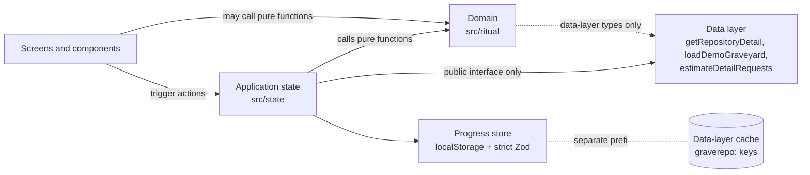
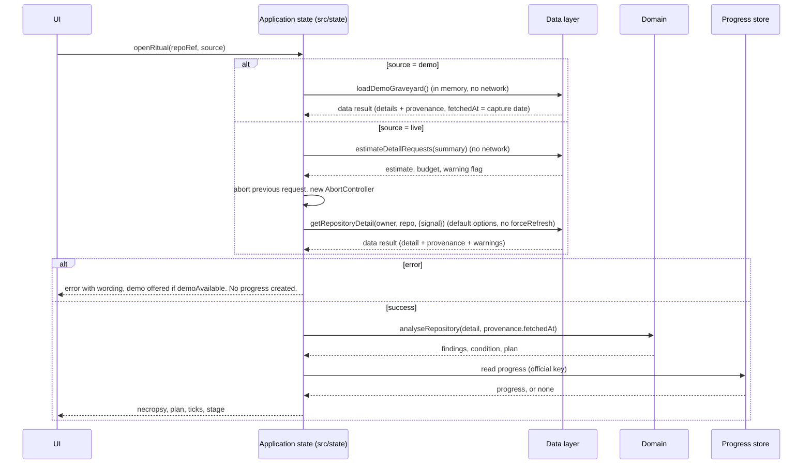

# Design: resurrection-ritual

**Status:** Draft for review (third revision, approvals recorded). Approved in this revision: O15, O17, O18, O19, O21, O22, O23 and O24, and O20 retained as specified. Anything marked Proposed or Open (O1–O16, except those approved) is explained in `requirements.md`, "Decision list". Nothing marked that way is final.

## 1. Overview

The ritual turns one repository's `RepositoryDetail` (from the data layer or the demo graveyard) and a reference time into four stages:

| Stage | What the visitor sees | Where it comes from |
|---|---|---|
| Necropsy | Findings (facts), one condition (interpretation), data source and warnings | Pure domain functions on the detail and reference time |
| Plan | An ordered, read-only list of suggested steps, each with its evidence | Pure domain functions on the findings |
| Rising | The same steps as a checklist, progress text and a meter | Domain progress functions plus saved ticks |
| The Living | Repositories the visitor marked as revived | Saved revived records |

Design principles:

1. **Everything is derived, nothing is invented.** Each finding and plan item points to raw fields of the detail. Calculated values are labelled as derived.
2. **Pure rules, thin state.** The rules are plain functions with no clock, network, storage or Zod. The state layer connects them to the data layer, storage and screens.
3. **Same rules for demo and live.** No rule reads the provenance source, route or stale flag. Only the reference time is passed in.
4. **Progress is the visitor's own.** It counts ticks only, never GitHub changes.
5. **Rules are enforced in logic, not in controls.** Stage entry, ticking and reviving are checked by domain and state functions.
6. **Plain and beginner-readable.** A rule table drives the plan, not clever code.

## 2. Architecture



### 2.1 Layers (proposals for `tech.md` to confirm)

| Layer | Location | Contents | Rules |
|---|---|---|---|
| Domain | `src/ritual/` | Types, findings, condition, plan rules, stage rules, progress maths, revive gate, wording functions, date helpers | Pure. No React, Zod, `fetch`, `localStorage`, `Date.now`. Imports data-layer **types** only. |
| Application state | `src/state/` | Ritual session state, state actions, progress store with Zod schemas, request cancellation | Uses the data layer's public interface and the domain. Never imports transports, adapters or schemas. |
| UI | `src/screens/ritual/`, `src/components/` | Four stage screens and shared components | Triggers state actions. Imports state functions, pure domain functions and data-layer types only. |

The folder names `src/ritual/` and `src/state/` are **proposals**. `tech.md` lists them as open, and this spec does not change `tech.md`. They stay proposals until you approve them (task 1.3).

### 2.2 Folder layout (proposed)

```
src/ritual/
  types.ts                  Finding, Evidence, DerivedValue, ConditionInput, Condition, PlanItem, RitualProgress, RevivedRecord, DisplayContext
  dates.ts                  subtractMonths, ageInMonths (display only), isOlderThanMonths (UTC, ISO strings)
  config.ts                 thresholds (O1, O17), plan rule order (O4). No garden values until O12 is approved.
  findings.ts               buildFindings(detail, referenceTime) -> Finding[]
  condition.ts              deriveCondition(conditionInput, referenceTime) (O18)
  plan.ts                   buildPlan(findings, referenceTime) -> Plan
  stages.ts                 canEnterStage, canToggle (pure predicates)
  progress.ts               progressPercent, remainingSteps, canMarkRevived, reconcileTicks, buildRevivedRecord
  wording.ts                text for findings, conditions, plan items, stages (keys + data + display context -> text)
  index.ts                  analyseRepository(detail, referenceTime) -> Necropsy result
src/state/
  ritual-session.ts         current repository, stage, detail result, estimate, actions (including applyStageChange)
  progress-store.ts         read/write/list localStorage, strict Zod schemas, prefix graverepo-progress:
  ritual-requests.ts        AbortController handling for detail requests
src/screens/ritual/         Necropsy, Plan, Rising and Living screens
src/components/             StageIndicator, FindingRow, PlanChecklist, ProgressMeter, Notice, ...
tests/ritual/               unit, property and integration tests
```

Garden component and garden config are added only after O12 is approved.

## 3. Data flow

### 3.1 Opening a tombstone



- **Reference time:** `RepositoryDetail` has no fetch time. The state layer reads `provenance.fetchedAt` from the data result and passes it to the domain. For demo it is the provenance of the `loadDemoGraveyard` result (the capture date) (O2).
- **Request estimate while pending:** the estimate, budget and warning flag from `estimateDetailRequests` are kept in the session state. While the request is pending, the loading view shows the `may-not-complete` note if the flag is set. When the result arrives, the note comes from the result's `warnings` and replaces the pending one, so it is never shown twice. No budget is calculated by the ritual. If the repository summary is unknown, the estimate step is skipped.
- **Cancellation:** the state action owns the `AbortController`. A `cancelled` result is ignored. A late result from a replaced request is dropped, and cannot touch the current session or storage.
- **No progress on failure or on viewing:** no entry is written until the visitor moves stage, ticks or revives.
- **Display context:** the state layer (or app shell) reads the visitor's locale and time zone once from `Intl.DateTimeFormat().resolvedOptions()` and passes `{ locale, timeZone }` to the wording module (O21). The domain never reads them.

### 3.2 Reopening after a reload (MVP)

- No global "last open repository" pointer is stored (O16).
- After a reload the visitor reopens the same tombstone from the same source. `openRitual` loads the detail and reads the progress entry for `{source, owner, repo}`. A valid entry restores the stage and ticks.
- **Demo:** the demo loads from memory. No GitHub request.
- **Live:** `getRepositoryDetail` is called with the default options. The data layer's cache rules apply as they are: a fresh copy (under 30 minutes) comes back without a request, a stale copy is refreshed, and a failed refresh can return the stale copy with its error. The ritual keeps no detail cache of its own, never passes `forceRefresh` and does not add cache behaviour. If the data layer has no copy and the request fails, the ritual does not open, and saved progress stays untouched (Req 8.14).
- If the refreshed detail gives a different plan, ticked IDs are kept and progress is recomputed. **Plan-changed note (approved, O23, Option A):** the note is shown only when the newly loaded data has a reference time different from the saved `evidenceFetchedAt` and at least one saved ticked ID is not among the new plan's item IDs. It is not shown merely because the data was refreshed, and not when the plan only gains items. The old plan is not stored and the entry schema does not change, so that is a documented limitation. The check compares the saved `tickedItemIds` with the IDs of the new plan's items, nothing else.

### 3.3 Moving through the stages

Rules live in `stages.ts` (pure predicates `canEnterStage` and `canToggle`). The state action `applyStageChange(target)` calls them and refuses invalid moves. Controls reflect the result but do not enforce it.

| Request | Allowed when | Result |
|---|---|---|
| Enter Necropsy, Plan or Rising | Always (before or after revival), from any stage, including forward skips such as Necropsy to Rising (O19) | Stage saved (a write, see 7.3). |
| Enter The Living | `revived` is not `null` | Otherwise refused. Stage unchanged, no write. |
| Tick or untick an item | `revived` is `null` | Otherwise refused. Ticks unchanged. |
| Mark as revived | `revived` is `null` and `canMarkRevived` is true | Writes the revived record and sets the stage to `living` in one write. Otherwise refused. |

- After revival, earlier stages can be viewed read-only. Ticks stay locked. The Living can be re-entered, but the first entry to The Living is only by marking as revived.
- A progress entry with the stage `living` and no revived record is invalid on read (section 7).
- Entering a stage the visitor is already on is not a write.

### 3.4 Marking as revived and The Living list

1. `markRevived()` runs `canMarkRevived(plan, progress)`. If false, nothing is written.
2. It builds the revived record with `buildRevivedRecord`, using the session's reference time as `evidenceFetchedAt` (the same value written to the entry, section 7.3), and writes the entry once.
3. `listRevived()` reads every `graverepo-progress:v1:` entry, keeps valid ones with a revived record, skips invalid ones silently, adds records revived in this session that could not be saved (O22), and sorts by `revivedAt`, newest first. It never reads `graverepo:` keys and sends no request.

## 4. Findings and conditions

### 4.1 Types (shapes, not code)

**Evidence** (raw): `field` (a path into the detail, such as `core.pushedAt`, `core.isArchived`, `isEmpty`, `renamedFrom`, `sections.readme`) and `value` (as read).

**Derived value:** `name` (for example `ageMonths`), `value`, `computedFrom` (the evidence fields it used) and `referenceTime`. Derived values are never stored as evidence and never shown as GitHub fields.

**Finding**

| Field | Meaning |
|---|---|
| `id` | Stable string, see the catalogue |
| `state` | `available`, `unavailable` or `not-applicable` |
| `reason` | For `unavailable` and `not-applicable`: the data layer's reason (`empty-repository` or `issues-disabled` for not-applicable) |
| `value` | Structured value read from the evidence. Never invented. |
| `isLowerBound` | True when the data layer marked the count "at least" |
| `role` | `actionable` or `informational` |
| `informationalReason` | `fact-only`, `no-action-needed`, `not-applicable` or `unavailable` |
| `evidence` | Non-empty list of raw evidence. It includes every raw field used to produce the value or the role. |
| `derived` | List of derived values (may be empty) |

**Condition input:** `isArchived` (boolean), `isEmpty` (`true`, `false` or `null` for unknown) and `pushedAt` (ISO date or `null`). For a detail they are `core.isArchived`, `isEmpty` and `core.pushedAt`. For a tombstone they come from the repository summary, with `isEmpty` always `null` (O18).

**Condition:** `id`, `kind: interpretation`, `basedOn` (the raw evidence fields the rules read: `core.isArchived`, `isEmpty` when known, `core.pushedAt`), and a derived `ageMonths` (display-only whole months, or null). `ageMonths` never decides the condition.

**Signatures (single source for the other sections):**

| Function | Input | Output |
|---|---|---|
| `deriveCondition(conditionInput, referenceTime)` | Condition input, reference time | Condition |
| `buildFindings(detail, referenceTime)` | Detail, reference time | Findings in catalogue order |
| `analyseRepository(detail, referenceTime)` | Detail, reference time | Necropsy result. It builds the condition input from the detail and calls `deriveCondition`. |

**DisplayContext:** `{ locale, timeZone }`, passed into every wording function that formats a date (O21).

**Plan item:** `id`, `position`, `findingId`, `evidence` (copied from the finding), `derived` (values the rule used), `because` (structured fact), `step` (wording key and data), `required`.

**Necropsy result:** `findings`, `condition`, `plan`, `referenceTime`. Switched-off sections leave no trace in the result.

### 4.2 Finding catalogue (proposed order, O4)

A finding appears only when the "Present when" column says so. **Omitted** means no finding exists. It is not a state.

| # | ID | Raw field(s) | Present when | States | Omitted when |
|---|---|---|---|---|---|
| 1 | `renamed` | `renamedFrom`, `core.owner`, `core.name` | `renamedFrom` is set | `available` | `renamedFrom` is null |
| 2 | `archived` | `core.isArchived` | true | `available` | false |
| 3 | `empty` | `isEmpty` | true | `available` | false |
| 4 | `last-update` | `core.pushedAt` | always | `available`, or `unavailable` when null | never |
| 5 | `latest-commit` | `sections.latestCommit` (plus `core.pushedAt`, as evidence of availability only, for the role rule in 4.4) | always (core section) | `available`, `unavailable`, `not-applicable: empty-repository` | never |
| 6 | `fork` | `core.isFork` | true | `available` | false |
| 7 | `readme` | `sections.readme` | always (core section) | `available`, `unavailable` | never |
| 8 | `open-issues` | `sections.openIssues` | always (core section) | `available` (count, lower bound), `unavailable`, `not-applicable: issues-disabled` | never |
| 9 | `oldest-open-issue` | `sections.openIssues` (`oldest`) | open-issues is `available` with count of at least 1 and `oldest` is present | `available` | open-issues is unavailable, not applicable, or count 0, or `oldest` is missing |
| 10 | `recent-authors` | `sections.recentAuthors` | section is not `section-disabled` | `available`, `unavailable`, `not-applicable: empty-repository` | `section-disabled` |
| 11 | `branches` | `sections.branches` | section is not `section-disabled` | `available`, `unavailable` | `section-disabled` |
| 12 | `ci` | `sections.ci` | section is not `section-disabled` | `available`, `unavailable` | `section-disabled` |
| 13 | `dependency-file` | `sections.manifest` | section is not `section-disabled` | `available`, `unavailable`, `not-applicable: empty-repository` | `section-disabled` |

Notes:
- **Not applicable versus omitted.** `not-applicable` is a result the data layer reports for a section that cannot apply (empty repository, issues turned off). The finding exists and says so. A switched-off optional section (`section-disabled`) is a configuration choice: no finding, no wording, no plan item.
- **Unexpected `not-applicable` reasons.** The table lists the reasons the data layer can give for each section. If a section reports a `not-applicable` reason that is not listed for it (for example `issues-disabled` on `readme`, or `section-disabled` on a core section), the finding is `unavailable` with that reason carried as given. It uses the "couldn't be checked" wording, is informational (`unavailable`), and never creates a plan item. Only `section-disabled` on an optional section (rows 10–13) is omitted.
- **Issues turned off** is the `not-applicable: issues-disabled` state of `open-issues`. There is no separate "issues turned off" finding. `oldest-open-issue` is omitted in this case, so nothing is shown twice.
- **Empty repository.** The `empty` finding states the fact once ("This repository has no commits yet"). Findings that are `not-applicable: empty-repository` may be grouped under it on screen as "Not applicable: this repository has no commits yet". They stay in the result.
- **Open issues cases** (see the limitation in `requirements.md`). The wording in the second row is approved (O15) and is **not** the voice document's "No issue found in the first 100 open items", because the data layer's types do not prove that 100 items were read.

| Data | `open-issues` finding | `oldest-open-issue` |
|---|---|---|
| count 0, `isLowerBound` false | "No open issues" | omitted |
| count 0, `isLowerBound` true | "No open issue found. The count may be incomplete." (O15, approved) | omitted |
| count at least 1 | "{n} open issues" or "At least {n} open issues" | "Oldest open issue from {date}" (omitted if `oldest` is missing) |
| section `unavailable` | "Open issues couldn't be checked" | omitted |
| `not-applicable: issues-disabled` | "Not applicable: issues are turned off" | omitted |

- If task 1.4 finds that the final types explicitly record "100 items were read", the second row may use the voice document's line instead, but only after you approve that specific change. Until then the approved O15 wording stands. If the types cannot separate rows 1 and 2, task 3.2 stops and reports.
- Only what the data layer returns is used. No licence, topics, language analysis, stars or code analysis.
- `last-update` means the core `pushedAt` (O3). The latest commit date is a separate finding. The latest commit's author can be missing, and the wording then drops the author.
- When the data layer reports `unavailable: rate-limited`, the finding is `unavailable` with that reason, and the wording explains that GitHub ran out of lookups (voice 5.9).

### 4.3 Condition rules (O1, O17, O18)

`deriveCondition(conditionInput, referenceTime)` takes the three fields of the condition input (4.1). First match wins:

| Order | Condition | Rule |
|---|---|---|
| 1 | `archived` | `isArchived` is true |
| 2 | `empty` | `isEmpty` is true (`null`, unknown, never matches) |
| 3 | `last-update-unknown` | `pushedAt` is null |
| 4 | `recently-updated` | `pushedAt` is **not earlier than** `cutoff12` |
| 5 | `resting` | `pushedAt` is earlier than `cutoff12` and **not earlier than** `cutoff24` |
| 6 | `dormant` | `pushedAt` is earlier than `cutoff24` |

**Cutoffs.** `cutoff12 = subtractMonths(referenceTime, 12)` and `cutoff24 = subtractMonths(referenceTime, 24)`. `subtractMonths` works on the reference instant in UTC, keeps the time of day, and clamps the day (31 March minus 1 month gives 28 or 29 February; 29 February minus 12 months gives 28 February). Dates are parsed from ISO strings to instants and compared as instants.

**Boundary table (all in UTC):**

| `pushedAt` compared with the cutoffs | Condition (if rows 1–3 did not match) | Role comparison "older than 12 months" |
|---|---|---|
| later than the reference time (future) | `recently-updated`, displayed age 0 | not older |
| exactly `cutoff12` | `recently-updated` | not older |
| one second earlier than `cutoff12` | `resting` | older |
| exactly `cutoff24` | `resting` | older |
| one second earlier than `cutoff24` | `dormant` | older |

- `isOlderThanMonths(date, n, referenceTime)` is true exactly when `date` is strictly earlier than `subtractMonths(referenceTime, n)`. The condition rules and the role rules (4.4) use this one function, so they cannot disagree.
- **Display age.** `ageInMonths` returns the largest whole `n` for which `subtractMonths(referenceTime, n)` is not earlier than the date, or 0 for a future date. It is used only for text such as "14 months ago". It does not choose the condition. A push one second before `cutoff12` can therefore read "Resting · last updated 12 months ago". This is correct, because the date is just past the 12-month line.
- **Relation to the data layer.** The condition uses `pushedAt`. The data layer's 12-month activity window applies to the latest commit date and only decides whether recent authors are requested. The two share the length but not the field, and the data layer does not define its boundary arithmetic. The ritual does not read the data layer's window, and never states that "recently updated" means "inside the activity window".
- Thresholds (12 and 24) are constants in `config.ts` and nowhere else.
- **Future dates.** A `pushedAt` later than the reference time (for example a device clock difference, since the reference time comes from the browser at fetch time) is not earlier than `cutoff12`, so it gives `recently-updated`. The wording shows the date only: "Last updated {date}". It shows no relative phrase and no negative number, and says nothing about the date being wrong, because there is no evidence why it is later.
- **Tombstone use (O18, approved, default A).** The dashboard calls the same function with the repository summary's `isArchived` and `pushedAt`, `isEmpty: null`, and the list's `provenance.fetchedAt` as the reference time. `empty` therefore appears only in the Necropsy. The label is always paired with "last updated {time}". `isEmpty` is never inferred from missing or unrelated summary fields (for example `sizeKb`). `empty` appears only in the Necropsy, after the detail establishes it.
- Labels: "Archived", "Empty", "Last update not available", "Recently updated", "Resting", "Dormant" (voice 5.2). They are always shown with the fact ("Resting · last updated 14 months ago").
- **Archived is never shown as active.** There is no label, icon, caption or colour that says active, healthy or recently updated for an archived repository. Wording tests enforce this.

### 4.4 Role rules (actionable or informational)

Each rule belongs to exactly one finding. Only `available` findings can be actionable.

| Finding | Role | Reason when informational |
|---|---|---|
| `archived` | actionable (`review-archived`) | n/a |
| `empty` | actionable (`add-first-commit`) | n/a |
| `readme` | actionable when no README found, otherwise informational | `no-action-needed` |
| `latest-commit` | actionable when both `latest-commit` and `last-update` are `available` and `isOlderThanMonths(latestCommit.date, 12, referenceTime)` is true, otherwise informational (approved, O24). It uses the latest commit date, never `pushedAt`. `pushedAt` is evidence only because its availability is required | `no-action-needed` |
| `dependency-file` | actionable when a file is found and `isOlderThanMonths(manifest.lastChange, 12, referenceTime)` is true, otherwise informational | `no-action-needed` |
| `ci` | actionable when the latest run's conclusion is exactly `failure`, otherwise informational | `no-action-needed` |
| `open-issues` | actionable when the count is at least 1. Informational with count 0 and `isLowerBound` false (`no-action-needed`), or count 0 with `isLowerBound` true (`fact-only`, because the data layer cannot rule issues out). | see left |
| `renamed`, `last-update`, `fork`, `oldest-open-issue`, `recent-authors`, `branches` | informational | `fact-only` |
| any `unavailable` finding | informational | `unavailable` |
| any `not-applicable` finding | informational | `not-applicable` |

- "No workflow runs found" and "No dependency file found" are facts and are informational. Other CI systems exist, and the dependency check only looks at the root folder, so no step is suggested.
- Conclusions other than `failure` (for example `cancelled` or `timed_out`) are informational for MVP (part of O4). The conclusion is shown as GitHub gave it.

## 5. Plan

### 5.1 Rules (proposed, O4)

Items are ordered by this table. The position in the final list is the order among triggered rules.

| Order | Rule / item ID | Finding | Triggers when | Because (fact) | Suggested step |
|---|---|---|---|---|---|
| 1 | `review-archived` | `archived` | repository is archived | "Archived on GitHub" | "Decide whether this repository should stay archived." |
| 2 | `add-first-commit` | `empty` | repository has no commits | "This repository has no commits yet" | "Add a first commit so there is something to build on." |
| 3 | `add-readme` | `readme` | no README found | "No README found" | "Add a README that says what this project does." |
| 4 | `review-latest-commit` | `latest-commit` | see role rules | "Latest commit on {date}" | "Read the latest commit and note where you left off." |
| 5 | `check-dependencies` | `dependency-file` | see role rules | "{file} last changed on {date}" | "Check whether the dependencies in {file} still install." |
| 6 | `check-workflow-run` | `ci` | conclusion is `failure` | "Latest workflow run: {conclusion} on {date}" | "Look at the latest workflow run and see what its result tells you." |
| 7 | `review-open-issues` | `open-issues` | count at least 1 | "{n} open issues" or "At least {n} open issues" | "Look through the open issues, starting with the oldest." (without "starting with the oldest" when the oldest could not be found) |

Rules for the table:
- Every item is `required: true` for MVP (O5).
- The wording follows voice 5.3: "Because {fact}, you could {step}." Items never promise results or state causes.
- Wording above is **proposed**. Implementation uses only wording approved and added to the voice document (task 1.2 dependency).
- **Archived repositories.** `review-archived` comes first, and other triggered items follow (O7). The steps are suggestions only. The data layer does not report what can be done on an archived repository, so GRAVEREPO does not claim anything is possible. The Plan screen shows a note for archived repositories (proposed wording): "These steps are suggestions only. We can't tell whether they can be done while this repository stays archived." The `review-archived` step does not describe how to change the archive status.
- **Rules read findings only**, not the raw detail. Each plan item's `evidence` is copied from its finding, so it traces to the original detail fields. Derived values the rule used (such as `ageMonths`) are listed separately as derived.
- Consistency: an `unavailable` or `not-applicable` finding never triggers a rule, and a plan item exists only for an `available`, `actionable` finding.

### 5.2 Determinism

`buildPlan(findings, referenceTime)` is a pure function over an ordered rule table.

- No randomness, clock reads or object-key-order dependence.
- Rules use only finding values, derived values and the reference time.
- Item IDs equal rule IDs, so the same item has the same ID on every run.
- The plan does not depend on provenance source, route or stale flag.

### 5.3 What the Plan screen shows

- The standard intro: "Here's a suggested plan based on what we could see on GitHub."
- The ordered items with "Because {fact}" and the suggested step. Each can show its evidence (raw fields) and, labelled as derived, any calculated values.
- A note listing sections that couldn't be checked, with no suggestions derived from them.
- For archived repositories, the suggestions-only note.
- The empty plan wording (proposed, O6): "We didn't find anything to suggest from what we could see."
- The button to continue to the Rising.

## 6. Progress, Rising and revive

### 6.1 Functions

| Function | Input | Output |
|---|---|---|
| `reconcileTicks(plan, tickedIds)` | Plan, saved IDs | IDs that exist in the plan (others are kept in storage, not counted) |
| `progressPercent(plan, tickedIds)` | Plan, saved IDs | `null` when there are no required items, otherwise `floor(100 × done ÷ total)` using only IDs in the plan |
| `remainingSteps(plan, tickedIds)` | Plan, saved IDs | Whole number of unticked required items |
| `canMarkRevived(plan, progress)` | Plan, progress | True when `revived` is null and all required items are ticked, or there are none |
| `canToggle(progress)` | Progress | True when `revived` is null |
| `canEnterStage(progress, target)` | Progress, stage | See section 3.3 |
| `deriveCondition` | | Defined once in section 4.1 (`deriveCondition(conditionInput, referenceTime)`), not repeated here. `buildRevivedRecord` takes `wasArchived` from the detail's `core.isArchived`. |
| `buildRevivedRecord(...)` | Core summary, plan, source, times | The revived record (section 7.1) |
| `gardenStage(percent)` | `null` or 0–100 | **Not defined until O12 is approved.** No bands, stage count or placeholder exist in this spec. |

### 6.2 Guarantees

- `progressPercent` is an integer 0–100 or `null`. It is never 100 for an empty plan, and never 0 for an empty plan.
- 100 means the plan has at least one required item and every one is ticked.
- Ticking more items never lowers the percent (for sets A ⊆ B, percent(A) ≤ percent(B)).
- Unknown IDs never change the percent.
- Once defined, `gardenStage` never goes down when the percent goes up (P7, conditional on O12).

### 6.3 Rising screen content

- The checklist, with checkbox semantics (O8).
- Progress text ("{done} of {total} steps done"), or "no steps" wording when progress is `null`, and a meter.
- A garden picture with text equivalent **only after O12 is approved**. Before that, the Rising screen has no garden picture, and nothing else depends on it.
- "Progress saved on this device", or the "couldn't save" message.
- "Mark as revived", enabled only when `canMarkRevived` is true. When disabled, the remaining steps are stated as text and the control has an accessible explanation (for example `aria-describedby` pointing at that text).

### 6.4 Marking as revived

- The action runs the gate in the state layer, writes the revived record, and sets the stage to `living` in one write.
- It makes no network request and calls nothing outside the progress store.
- Confirmation: "Marked as revived in GRAVEREPO. This is saved on this device only." If the write fails (O22), the confirmation is replaced by the "couldn't save" wording ("We couldn't save your progress on this device. It will be lost when you close this page."), the revival still holds for the session, and The Living shows it from memory.
- Ticks are locked afterwards. Reset is not in MVP (O10).

## 7. Saved progress

### 7.1 Storage key and entry

| Item | Value |
|---|---|
| Prefix | `graverepo-progress:` (decided). The data layer's cache uses `graverepo:`. The two never overlap. |
| Key | `graverepo-progress:v1:{demo\|live}:{owner}/{repo}`, lowercase official names (O9). The `v1` in the key is the entry's `schemaVersion`. |
| Entries | One per repository per source |
| Version | One `schemaVersion` for the whole entry, including the nested revived record. It must equal the version in the key. |

| Entry field | Type |
|---|---|
| `schemaVersion` | the literal 1. Must equal the `v1` in the key. |
| `stage` | `necropsy`, `plan`, `rising` or `living` |
| `tickedItemIds` | list of strings |
| `evidenceFetchedAt` | ISO date, the reference time of the data the plan was last built from (7.3) |
| `startedAt`, `updatedAt` | ISO dates |
| `revived` | `null`, or the revived record |

| Revived record field | Type |
|---|---|
| `owner`, `repo` | official names, as GitHub spells them |
| `url` | GitHub web URL (only shown if it starts with `https://`) |
| `wasArchived` | boolean |
| `source` | `demo` or `live` |
| `evidenceFetchedAt` | ISO date, equal to the entry's `evidenceFetchedAt` written in the same write (7.3) |
| `requiredCount` | whole number (0 or more) |
| `revivedAt` | ISO date |

The revived record has no `schemaVersion` of its own.

### 7.2 Rules

- Reads and writes go through `progress-store.ts` only. The domain never touches storage, and Zod lives only in the state layer.
- **Strict validation.** The Zod schemas reject unknown fields (strict objects), wrong types and an unsupported `schemaVersion`. They also reject an entry whose `schemaVersion` differs from the version in its key, and an entry whose stage is `living` while `revived` is `null`. Unknown fields are never silently stripped.
- **Versions.** The store reads and lists only keys that start with `graverepo-progress:v1:` (the current version). A key with another version (`v2:` and so on) is never read, never deleted and never listed. There is no migration in MVP. Changing the schema means a new version number in both the key and the entry, decided in a later spec.
- The schema output must be assignable to the domain types (checked at compile time), so the two cannot drift.
- **Invalid entries (O20).** An invalid entry is treated as "not started" for that repository only. Its values are never read. It is **not deleted** and nothing else is touched. The next valid write for the same key replaces it. When listing The Living, invalid entries are skipped silently.
- Writes happen on each change. **A failed write, including a full or unavailable storage (O22),** leaves the in-memory copy in use and sets a "can't save" flag for the screens (voice 5.4). The next change tries to write again. No entry is deleted to make room, and no `graverepo:` key is touched. Records revived in this session whose write failed are kept in memory for The Living.
- The store enumerates only keys that start with `graverepo-progress:`. It never lists, reads or removes `graverepo:` keys.
- The data layer's cleanup removes only `graverepo:` keys and stays the data layer's responsibility. The ritual store never performs cache cleanup. A cache problem never erases progress.
- The store keeps IDs and choices only, plus the small revived record.
- The store keeps IDs and choices only, plus the small revived record.

### 7.3 When `evidenceFetchedAt`, `startedAt` and `updatedAt` are set

The state layer sets these, only when it writes the entry. The domain never sets them. The state layer takes the write time from an injected clock (so tests can fix it).

| Event | `evidenceFetchedAt` | `startedAt` | `updatedAt` |
|---|---|---|---|
| First write for a key (first stage move, tick or revive) | The session's reference time (`provenance.fetchedAt` of the data result in use) | Write time | Write time |
| Later write before revival (stage move, tick, untick) | Set to the session's reference time again. It is the data the visitor's current plan was built from. | Unchanged | Write time |
| Revival | Set to the session's reference time. The revived record gets the same value, in the same write. | Unchanged | Write time |
| After revival | Unchanged. No write changes it, and the revived record never changes. | Unchanged | Write time, when a stage move is written (stage navigation is the only write allowed after revival) |
| Opening, viewing, reading, a failed or cancelled request | Not written | Not written | Not written |
| An invalid entry replaced by a valid write | Treated as a first write | Write time | Write time |

- Because every write before revival stores the session's reference time, a reopen that loads newer data changes the stored value only when the visitor changes something. The plan-changed note (3.2, O23) compares the **stored** value, read before that first write, with the new reference time.
- Requirement 8.15 states the same rules.
- No new caching is introduced. The reference time is whatever the data layer reports.

## 8. Application state and screens

### 8.1 State actions

| Action | Effect |
|---|---|
| `openRitual(repoRef, source)` | Aborts any earlier request, loads the detail (demo from memory, live via the data layer with default options), keeps the estimate while pending, builds the necropsy with the reference time, restores progress |
| `applyStageChange(target)` | Uses `canEnterStage`. Saves the stage (7.3) and moves focus to the stage heading. Refused moves change nothing. Moving to the stage the visitor is on writes nothing. |
| `toggleItem(id)` | Uses `canToggle`. Ticks or unticks, saves, announces progress. Refused after revival. |
| `markRevived()` | Uses `canMarkRevived`. Saves the revived record and sets the stage to `living` in one write. If the write fails, the revival holds in memory for the session (O22). |
| `listRevived()` | Returns valid revived records plus unsaved ones from this session, newest first |
| `closeRitual()` | Aborts any running request. Keeps saved progress. |

- The state layer, not UI components, creates `AbortController`s, passes signals, aborts on `closeRitual` or when a newer `openRitual` starts, and drops late results (tech.md section 6).
- Each `openRitual` call carries a request token. A result is applied only if its token matches the current session. Anything else is dropped, so a late result cannot overwrite the current repository or write progress.
- Only the state layer calls `getRepositoryDetail`. For the demo it never calls it.
- A failed or cancelled detail request never creates progress.

### 8.2 Screens and states

| Screen | Content | Loading | Empty | Error | Partial |
|---|---|---|---|---|---|
| Necropsy | Provenance label, condition with its fact, findings in order, which findings lead to a step, warnings | "Checking this repository…", "Still checking: {sections}", and the `may-not-complete` note from the estimate while pending | n/a | Wording from voice 5.8. Demo offered only when `demoAvailable`. | Sections "couldn't be checked", `may-not-complete` (from the result) and `stale-data` notes |
| Plan | Intro, ordered items with because and step, unchecked sections note, archived suggestions-only note, continue button | None (derived) | "We didn't find anything to suggest from what we could see." | n/a | Unchecked sections note |
| Rising | Checklist, progress text and meter, save status, revive button, garden after O12 | None | "no steps" wording, and revive is enabled | "We couldn't save your progress on this device…" | Plan-changed note |
| The Living | List with captions, source and archive labels, the GitHub note, local-status wording | None (local read) | "No revived repositories yet. Finish a ritual and it will grow here." | Invalid entries are skipped silently | n/a |

- All screens have a text-equivalent view of anything graphic.
- Focus moves to the stage heading when the stage changes. Progress changes are announced with a polite live region. Errors use the alert role (tech.md section 11).
- Dates: one format, the visitor's locale and local time zone, passed in as the display context, on all four screens (O14, O21). Comparisons use UTC.
- The screens use the components in `design-system.md` section 5. Final colours, fonts and art are Open.
- Layout and the entry point to The Living are decided with the dashboard spec (O13).

## 9. Testing strategy

Vitest and fast-check. No test reaches GitHub. Every test in this section must be implemented (Req 13.1).

### 9.1 Test inputs

- `tests/ritual/builders.ts`: functions that build `RepositoryDetail` values with named overrides, and fast-check arbitraries. These are **test builders**, labelled as such, and are never GitHub data or demo data.
- Once the demo snapshot exists (data-layer task 6), normal-case tests also run on every demo repository's detail.
- State-layer tests use a fake data layer that returns data results with chosen provenance.

### 9.2 Unit tests

| ID | Subject | Checks |
|---|---|---|
| U1 | `dates` | `subtractMonths` clamps days and keeps the time of day (31 March minus 1 month, 29 February minus 12 months, leap and non-leap years). `isOlderThanMonths` is false at exactly 12 and 24 months and true one second earlier. `ageInMonths` (display only) at those points. Future dates give age 0. |
| U2 | Findings | Each finding for available, unavailable, not-applicable and omitted cases. Lower bounds. The five open-issues cases in section 4.2, including count 0 with a lower bound ("No open issue found. The count may be incomplete.", never "100" and never "No open issues") and `oldest` missing with count at least 1. Issues turned off is `not-applicable` on `open-issues` with no duplicate finding. An unexpected `not-applicable` reason gives `unavailable`. |
| U3 | Omitted versus not applicable | `section-disabled` leaves no finding, no wording and no plan item. `not-applicable` keeps a finding with its reason. Empty-repository findings can be grouped but are not dropped. |
| U4 | Condition | Precedence. Archived with a recent push is `archived`. `isEmpty` true beats age. `isEmpty` `null` (tombstone input) never gives `empty`, even when the summary has `sizeKb` 0 or no `pushedAt` (emptiness is never inferred, O18). `pushedAt` null gives `last-update-unknown`. The boundary table in 4.3: exactly `cutoff12` is `recently-updated`, one second earlier is `resting`, exactly `cutoff24` is `resting`, one second earlier is `dormant`. A future `pushedAt` gives `recently-updated`. The same input gives the same condition from a detail and from a summary with `isEmpty: null`. |
| U5 | Roles | Each actionable and informational case with its explicit reason. No unavailable or not-applicable finding is actionable. `latest-commit` cases (O24): actionable when both findings are `available` and the latest commit date is one second earlier than `cutoff12`. Informational at exactly `cutoff12`. Informational when `last-update` is `unavailable` (null `pushedAt`). Not actionable when `latest-commit` is `unavailable` or `not-applicable`. Latest commit old with a recent `pushedAt` is actionable. Latest commit recent with an old `pushedAt` is informational. |
| U6 | Plan | Each rule triggers and does not trigger. Order. Empty plan. Archived plan starts with `review-archived`. Plan evidence equals the finding's evidence and derived values are marked derived. `review-latest-commit` triggers only under the O24 rule, and its "because" fact uses the latest commit date. |
| U7 | Progress | 0, partial, 100. No required items gives `null`, not 0 or 100. Unknown IDs ignored. |
| U8 | Revive gate | Locked, unlocked, no-steps case allowed, already revived. |
| U9 | Garden | **Only after O12 is approved:** band boundaries. |
| U10 | Wording | Each finding, condition and plan item produces the approved voice text. Future-date wording has no relative phrase. Dates use the given display context: the same instant formats differently for two fixed time zones and two fixed locales, and the "UTC" label appears in the fallback. "Revived" always says GRAVEREPO. Archived suggestions-only note. The wording module reads no clock, locale or time zone. |
| U11 | Storage | Key format and prefix. Valid entry reads back. Strict schema rejects unknown fields, wrong types, wrong version, a `schemaVersion` that differs from the key's version, `living` without a revived record, and malformed nested records. A key with another version (for example `v2`) is not read, not listed and not deleted. An invalid entry is treated as missing and **not deleted**, and the next valid write for the same key replaces it. Other entries are unaffected. `evidenceFetchedAt`, `startedAt` and `updatedAt` follow the table in 7.3 (first write, later write, revival, after revival, view only). |
| U12 | Revived record | Contains exactly the allowed fields, with `evidenceFetchedAt` equal to the entry's value written in the same write, no email, and no separate schema version. |
| U13 | Purity | A test fails if a file in `src/ritual/` imports React, Zod, a transport, an adapter or a schema, or contains `fetch`, `localStorage` or `Date.now`. |
| U14 | Stage rules | The table in section 3.3: free movement among the first three stages including forward skips (Necropsy to Rising) and backward moves (O19), The Living refused before revival, ticking refused after revival, revive refused when the gate is false. Entering the current stage writes nothing. |
| U15 | Renamed (Req 10.7) | `renamedFrom` set gives the `renamed` finding with evidence `renamedFrom`, `core.owner` and `core.name`, and the wording "Now named {official name} (you opened {requested name})". `renamedFrom` null gives no finding. The progress key is built from the official lowercase name, never from the requested name. No other rename handling exists. |
| U16 | Demo and live independence (Req 8.12) | For the same owner and repo, the demo key and the live key differ. Ticking, reviving or an invalid entry under one never changes, reads or lists the other. `listRevived` shows each with its own source label. |
| U17 | Storage full (Req 8.8, 8.17, O22) | A write that throws (including a quota error) keeps the change in memory, sets the "can't save" flag, retries on the next change, and deletes no entry and no `graverepo:` key. A failed revival still revives for the session, shows the "couldn't save" wording instead of "saved on this device only", and appears in `listRevived` from memory. After a successful retry the flag clears. |
| U18 | After revival (Req 1.7, 6.13, 7.1) | After revival: ticking and unticking are refused and change nothing. `canMarkRevived` is false. A second `markRevived` changes nothing and does not rewrite the revived record or its `revivedAt`. Necropsy, Plan and Rising can be viewed and The Living can be re-entered. Stage moves write only `stage` and `updatedAt`. `evidenceFetchedAt` and the revived record never change. A newer plan with different items does not change the revived record, the revived status or the ticks, and shows no revive control. Progress text for the new plan is recomputed read-only. |

### 9.3 Property tests (fast-check)

| ID | Property |
|---|---|
| P1 | **Determinism.** For any detail and reference time, building the necropsy twice gives deeply equal results. |
| P2 | **Unknown stays unknown.** If any section or nullable field is unavailable, null or not applicable, its finding is not `available` and no plan item cites it. No finding value is `0` or a placeholder where the input was unknown. |
| P3 | **Traceability.** Every finding has at least one evidence reference whose field exists in the input and whose value equals it. Every plan item's evidence equals its finding's evidence and its finding is `available` and `actionable`. Derived values never appear in evidence lists. |
| P4 | **Actionable mapping.** The set of actionable finding IDs equals the set of plan item `findingId`s, one to one. No `unavailable` or `not-applicable` finding is actionable. Every informational finding has an explicit reason. |
| P5 | **Progress bounds.** For any plan and any set of IDs (including unknown IDs), the percent is `null` or an integer 0–100. It is `null` exactly when there are no required items, and 100 only when every required item is ticked. |
| P6 | **Monotonic progress.** For ticked sets A ⊆ B, percent(A) ≤ percent(B). Adding unknown IDs never changes the percent. |
| P7 | **Garden is monotonic.** **Only after O12 is approved:** if p ≤ q then `gardenStage(p)` ≤ `gardenStage(q)`. |
| P8 | **Archived is never active.** For any detail with `isArchived` true, the condition is `archived`, and the generated labels and captions never contain "active", "recently updated" or "healthy". |
| P9 | **Revive gate.** `canMarkRevived` is true exactly when not revived and every required item is ticked (or none are required). |
| P10 | **Wording safety.** For any detail, the fixed template text (with data values such as names, files and conclusions replaced by neutral placeholders) contains none of the avoided words (dead, deceased, killed, abandoned, forsaken, rotting, neglected, gone, hopeless), and every use of "revived" is paired with "GRAVEREPO" or the local-only note. Data values from GitHub are shown as given and are not checked. |
| P11 | **Provenance parity.** Through the state layer, the same detail delivered with different provenance source, route and stale flag, and the same `fetchedAt`, gives identical findings, condition and plan. |
| P12 | **Plan structure.** Item IDs are unique, positions run 0..n-1, order follows the rule table, and items appear only for triggered rules. |
| P13 | **Storage round trip.** Serialising and reading back any valid progress gives the same value. Arbitrary strings and objects with extra fields read as "missing" without throwing. Every generated key starts with `graverepo-progress:` and never with `graverepo:`. |
| P14 | **Dates.** `subtractMonths(d, n)` is not later than `d`, and `isOlderThanMonths` is monotonic in `n`. |
| P15 | **Stage safety.** For any random sequence of state actions (`applyStageChange` to any stage, tick any ID, mark revived) applied to a model: The Living is the stage only when a revived record exists, a revived record exists only if the gate was true when it was created, and the ticks never change after revival. |
| P16 | **Condition boundaries.** For any condition input and reference time, `deriveCondition` agrees with direct comparisons of `pushedAt` against `cutoff12` and `cutoff24`. Precedence holds (archived, then empty, then unknown, then age). For `pushedAt` values p ≤ q (neither null), rank(p) ≥ rank(q), where recently-updated is 0, resting is 1 and dormant is 2 (an older push never ranks lower). The result never depends on `ageInMonths`. |

Keep generated lists small. Save any failing case as an ordinary unit test.

### 9.4 Integration tests

| ID | Scenario |
|---|---|
| I1 | **Complete demo ritual with GitHub blocked.** Load the demo, open a tombstone with a non-empty plan, complete Necropsy, Plan and Rising, mark as revived, see it in The Living. `fetch` fails the test if called for GitHub. This extends data-layer requirement 8.19. |
| I2 | **Reopen after reload.** Tick some items, rebuild the state from storage (a new session), reopen the same repository from the same source, and the stage and ticks match. No global pointer exists, and no request goes to GitHub in demo mode. |
| I3 | **Invalid entry.** A corrupt entry and an entry with an unknown field are ignored for their repository, are not deleted, and do not affect other entries or The Living. |
| I4 | **Cache cleanup keeps progress.** With both `graverepo:` and `graverepo-progress:` keys present, the data layer's cleanup removes only the first group, and the progress store removes no `graverepo:` key. This is a regression test for the prefix decision. |
| I5 | **Live error paths and estimate warning.** Fake data-layer errors (rate limit, offline, not found) show the voice wording, offer the demo only when `demoAvailable`, and create no progress. A pending request shows the `may-not-complete` note from the estimate once, then from the result's warnings, never twice. |
| I6 | **Cancellation.** Opening a second tombstone aborts the first request. A late first result is dropped, does not change the session and does not write progress. A cancelled request creates no progress. |
| I7 | **Plan changed after refresh.** Ticked IDs are kept and progress is recomputed. The plan-changed note shows when the saved `evidenceFetchedAt` differs from the new reference time and a saved ticked ID is no longer in the plan. It does not show when the reference times match, and does not show for a plan that only gained items. It does not show merely because the reference time changed with all saved ticked IDs still in the plan (O23). The stored entry has no plan field. |
| I8 | **Demo parity.** Every demo repository analyses without error. At least one gives a non-empty plan, or the test reports it (it does not change the snapshot). |
| I9 | **Live reopen through the data layer's cache.** Reopening a live repository calls `getRepositoryDetail` with the default options, never `forceRefresh`, and the ritual keeps no detail cache of its own. |
| I10 | **Revive makes no requests (Req 7.6).** With a fake data layer and a spying `fetch`, marking as revived for a demo repository and for a live repository makes zero calls to the data layer, to `fetch` and to any storage key outside `graverepo-progress:`. The data layer's functions are not called after the detail was loaded. |
| I11 | **Reload after revival.** Revive a repository, rebuild the state from storage (a new session), reopen the same repository from the same source: the stage is `living`, ticks are locked, the revived record is unchanged, and The Living lists it. No request goes to GitHub in demo mode. A reload with a failed revival write shows nothing in The Living (the in-memory record is gone) and the "couldn't save" message was shown at revival time. |
| I12 | **Live renamed repository (Req 10.7).** A fake live detail with `renamedFrom` shows "Now named {official name} (you opened {requested name})". Progress is saved under the official lowercase name. The ritual calls nothing beyond `getRepositoryDetail`. |

### 9.5 Manual checks (checkpoint)

- Keyboard-only path through all four stages (check 6). Automating this depends on the component test tool, which is Open in `tech.md`.
- Reduced motion, 200% zoom and a screen reader pass on the ritual screens (roadmap 1 December).
- Reload, reopen the same repository, and confirm stage and ticks in a real browser (check 3, see O16).

## 10. Wording

- All ritual text lives in `src/ritual/wording.ts` as pure functions of keys, data and an explicit display context `{ locale, timeZone }` (O11, O14, O21). Dates are formatted with `Intl` against the reference time and the given context, never the clock, and never the browser's own locale or zone. The state layer or app shell supplies the context (3.1).
- Wording follows `voice-and-honesty.md`. Proposed wording (plan items, empty plan, finding order, archived suggestions-only note, future-date form, the open-issues "No open issue found. The count may be incomplete." line, the plan-changed note, the revive-disabled explanation and the pending request-estimate note) is listed in sections 4 to 8. It must be approved and added to the voice document before implementation uses it.
- Shared error text for data-layer errors belongs to one shared module that the dashboard spec also uses. The ritual only calls it.
- The wording module returns structured parts (label, fact, source) so Lantern Mode can present them in another way.

### 10.1 Approved wording (task 1.2 done: added to `voice-and-honesty.md` 5.1 to 5.4, 5.8 and 5.10)

All lines below are approved and are now in `voice-and-honesty.md`, which is the source of truth. The revive-disabled line uses the approved final form.

| Item | Proposed wording | Where used |
|---|---|---|
| Empty plan | "We didn't find anything to suggest from what we could see." | Plan screen (5.3), Req 5.11 |
| Plan-changed note | "This plan changed because newer GitHub data was available. Your ticks are kept, and progress now counts the current steps." | Rising and Plan screens (3.2), Req 8.11. Wording approval is still pending (task 1.2). |
| Revive-disabled explanation | "{n} steps left before you can mark this repository as revived in GRAVEREPO." (singular: "1 step left before you can mark this repository as revived in GRAVEREPO.") | Rising screen (6.3), Req 7.2 |
| Pending request-estimate note | Reuses the approved `may-not-complete` line from voice 5.8, "GitHub may run out of lookups before we finish checking this repository. We'll show what we can." The approval needed is that the same line may be shown while the request is pending. | Necropsy loading (3.1), Req 10.9 |
| Open issues, count 0 with a lower bound | "No open issue found. The count may be incomplete." (O15) | Necropsy (4.2), Req 2.12 |
| Archived suggestions-only note | "These steps are suggestions only. We can't tell whether they can be done while this repository stays archived." | Plan screen (5.1), Req 5.14 |
| Future-date form | "Last updated {date}" with no relative phrase | Necropsy (4.3), Req 3.8 |
| Plan item wording and finding order | Sections 4.2 and 5.1 | Plan, Necropsy |
| UTC fallback label | A date formatted in the fallback zone carries "UTC" (O21) | All screens, Req 11.10 |

## 11. Cuts, risks and what is not included

**Cut order inside this spec** (see requirements priority): garden pictures and animation (not started before O12), then the plan-changed note, then component-level keyboard tests (keep the manual check).

**Risks**

| Risk | Mitigation |
|---|---|
| The ritual logic shares Tuesday 24 November with the demo snapshot | Domain work uses test builders and does not wait for the demo. Property tests can finish on 25 November if needed, but screens on 26 November cannot move. |
| Plan wording is not yet approved | Wording is in one file, so changes are cheap. Implementation waits for approved wording. |
| Open-issues "count 0 with a lower bound" cannot be told apart, or is not explicit, in the data layer | The approved wording (O15) claims no number of items. Tasks 1.4 and 3.2 verify the types and stop if the cases cannot be separated (O15). |
| No demo repository gives a non-empty plan | Checked in task 15.2 and data-layer task 6.3. Report before touching the snapshot. |
| Garden art is undecided | The Rising screen works without a garden. |

**Not included:** obituary card, time-lapse, undo of "revived", cross-tab sync, global "last open" pointer, README content analysis, licence, tests or dependency-version checks, a refresh button using `forceRefresh`, anything that writes to GitHub.
