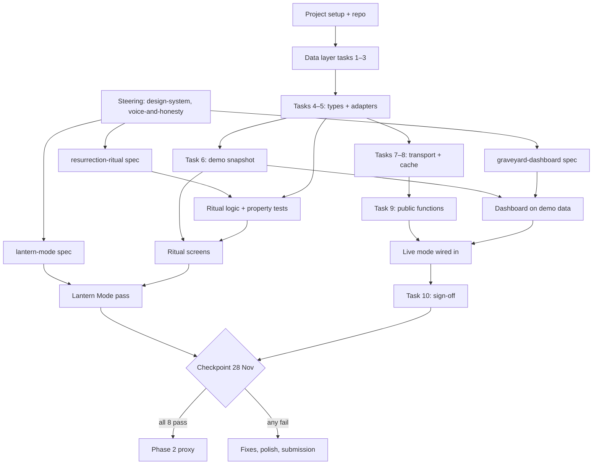

# GRAVEREPO roadmap (solo developer)

This is the single source for GRAVEREPO's schedule, priorities, dependencies and checkpoint. Feature details live in the specs under `.kiro/specs/`.

## Key dates

| Event | Date and time |
|---|---|
| Submission period opened | 30 October 2026 (all work must start on or after this date) |
| Checkpoint | End of Saturday 28 November 2026, Malaysia time (UTC+8) |
| Proxy cut-off (Phase 2) | End of Monday 30 November 2026, Malaysia time |
| Official deadline | Friday 4 December 2026, 2:00 PM PT = **Saturday 5 December, about 6:00 AM Malaysia time** |
| Working deadline | Evening of Friday 4 December, Malaysia time. Submit then, and keep the remaining hours as a buffer. |

## Priority order

When time is short, higher items win. Lower items never delay higher ones.

1. **Demo graveyard and the complete Resurrection Ritual** (Necropsy → Plan → Rising → The Living)
2. Live GitHub search and the dashboard
3. Lantern Mode and accessibility
4. Visual atmosphere and decoration
5. Phase 2 proxy
6. Optional features (obituary card, time-lapse, branch dates, registry checks)

**Rules:**
- Decoration starts simple: static SVG mascots and decorative elements. Animation is added only once the core journey works, and every animation needs a reduced-motion version.
- No additional GitHub analysis is added before the checkpoint.
- If behind, switch off optional detail sections in this order: manifest, branch count, CI, recent authors (D26). Core metadata, README, latest commit and open issues always stay.

## Specs and steering

| Item | Type | Status | Needed by |
|---|---|---|---|
| `github-data-layer` | Spec | Approved | 22 Nov |
| `design-system.md` | Steering | To write | Before the dashboard and ritual specs (22 Nov) |
| `voice-and-honesty.md` | Steering | To write | Before the ritual spec and error messages (22 Nov) |
| `resurrection-ritual` | Spec | To write | 22 Nov (covers signals, plan rules, the Rising and saved progress; D25) |
| `graveyard-dashboard` | Spec | To write | 23 Nov |
| `lantern-mode` | Spec | To write | 24 Nov |

## Daily schedule

The data-layer task numbers refer to `.kiro/specs/github-data-layer/tasks.md`.

| Date | Specs and steering | Data layer | App and UI |
|---|---|---|---|
| **Sun 22 Nov** | `design-system.md`, `voice-and-honesty.md`, `resurrection-ritual` spec | Tasks 1–3 (preparation, fixtures, catalogue) | Project setup and GitHub repository creation |
| **Mon 23 Nov** | `graveyard-dashboard` spec | Tasks 4–5 (types, errors, schemas, adapters) | — |
| **Tue 24 Nov** | `lantern-mode` spec | **Task 6: demo snapshot ready** | Ritual logic (signals, plan rules, progress) and its property tests |
| **Wed 25 Nov** | — | Tasks 7–8 (direct transport, rate limits, cache) | Dashboard using demo data |
| **Thu 26 Nov** | — | Task 9 (public functions, detail runner) | Necropsy, Plan, Rising and The Living screens |
| **Fri 27 Nov** | — | Task 10 (security, privacy, sign-off) | Live mode wired in, Lantern Mode pass, deploy in direct mode |
| **Sat 28 Nov** | — | Task 11: **checkpoint** | Fixes needed to pass the checkpoint |
| **Sun 29 – Mon 30 Nov** | — | Task 12: proxy, **only if the checkpoint passed** | Otherwise polish and bug fixes |
| **Tue 1 Dec** | — | — | Accessibility audit, README |
| **Wed 2 Dec** | — | — | Record the demo video (under 3 minutes, public on YouTube, no copyrighted music) |
| **Thu 3 Dec** | — | — | Kiro write-up, Devpost draft |
| **Fri 4 Dec** | — | — | Final checks and submission |

**Keep a running journal.** Add notes to `docs/kiro-journal.md` every day: specs, steering, hooks, custom agents, MCP, property-based testing, IDE versus CLI. The 3 December write-up is built from these notes.

## Dependencies

**Critical path:** steering → `resurrection-ritual` spec → data-layer tasks 4–5 → demo snapshot → ritual screens → checkpoint. A delay on any of these delays the hero feature, so they come first each day.

**Live mode is not on the critical path for the demo.** If tasks 7–9 slip, the dashboard and ritual still work on demo data.

## Checkpoint (end of Saturday 28 November 2026, Malaysia time)

Phase 2 may start only if **all eight** checks pass.

| # | Check | How to verify |
|---|---|---|
| 1 | The app is deployed at a public URL in direct mode | Open it in a private browser window |
| 2 | The demo works with GitHub blocked: open the demo, open a tombstone, complete Necropsy, Plan and Rising, and mark the repository revived. It appears in The Living. | Block `api.github.com` in DevTools and confirm 0 requests reach it |
| 3 | Ritual progress survives a page reload | Reload in the middle of a ritual |
| 4 | Live search works for a user and an organisation, and an opened tombstone shows real signals with their provenance | Manual check |
| 5 | Rate-limit, not-found and offline cases show helpful messages and offer the demo | Tests with constructed fixtures, plus one manual offline check |
| 6 | Keyboard-only path through the ritual works, and reduced motion is respected | Manual check |
| 7 | All tests pass: data layer, ritual logic, property tests, token and email scans, and the "no GitHub requests in demo" test | Test run |
| 8 | No known bug blocks the core user journey | Bug list |

Record each result in `docs/kiro-journal.md`.

**If any check fails:**
- The proxy is dropped. Its tasks move to "Deferred", and the Phase 2 requirements are marked "not delivered".
- The README describes GRAVEREPO as direct mode plus the demo, and explains the 60-requests-per-hour limit.
- No MVP code changes are needed, because nothing in Phase 1 depends on Phase 2.
- 29 November to 4 December go to fixing the failed checks, polish and the submission.

**Even if all checks pass:** the proxy must be deployed and tested by the end of 30 November. If it isn't, it's dropped in the same way.

## If a day slips

1. Never move the demo snapshot (24 Nov) or the ritual screens (26 Nov) later to make room for anything else.
2. Shorten the `lantern-mode` spec by writing its acceptance criteria into the dashboard and ritual specs instead.
3. Switch off optional detail sections (D26 order).
4. Postpone decoration and animation work to 29 November or later.
5. If 1 December is lost, fold the accessibility audit into the checkpoint fixes and keep 2–4 December for the video, write-up and submission.

## Submission checklist (from the hackathon rules)

- [ ] Public GitHub repository with all source code, assets and instructions
- [ ] Open source licence visible in the repository's About section
- [ ] `/.kiro` folder at the root and not listed in `.gitignore`
- [ ] Working app URL, with any test instructions in the private Devpost form
- [ ] Text description of the features
- [ ] Demo video under 3 minutes, public on YouTube, showing the app working, with no copyrighted music or third-party trademarks without permission
- [ ] Kiro write-up covering specs, hooks, steering, custom agents, MCP, property-based testing and which Kiro apps were used
- [ ] Category: Costume Contest, plus any bonus prizes selected
